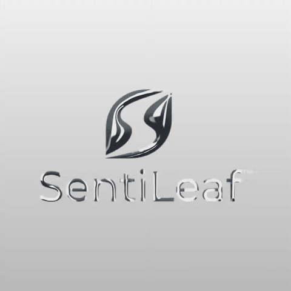
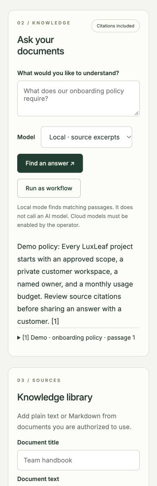
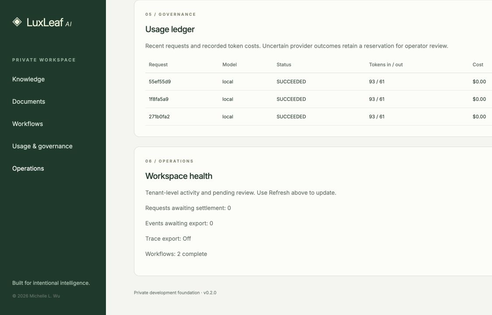

# LuxLeaf AI

**A business AI platform bringing private knowledge, governed model access, and repeatable workflows into one workspace.**

LuxLeaf is being developed by Michelle L. Wu. This repository is its public product showcase: capabilities, architecture, synthetic demonstrations, and development direction. The backend application source is maintained privately; the four visual product repositories are public again under their stated licenses. Public demonstrations are available here.

**Status:** v0.3 development preview. There is no public hosted service or downloadable application in this repository.

[Integration roadmap](docs/INTEGRATIONS.md) · [Product & technical brief](docs/TECHNICAL_BRIEF.md) · [Product overview](docs/PRODUCT.md) · [Architecture](docs/ARCHITECTURE.md) · [Roadmap](docs/ROADMAP.md) · [Validation](docs/VALIDATION.md) · [Security](SECURITY.md)

## Videos for all four visual products

**[Watch the complete visual demo gallery](docs/VISUAL_DEMOS.md)** — Scene Kit geometry and lighting, Glass UI refraction, three Gradient Studio films, and Metal Mark’s AULIN and SentiLeaf demonstrations. Every product has a recorded video and reproduction instructions.

## SentiLeaf in motion

**[Watch the SentiLeaf demo and read what changed](docs/demonstrations/sentileaf-liquid-metal.md)** — actual browser-rendered motion with corrected logo/background separation and matching video export. [Visual product status](docs/VISUAL_PRODUCTS.md). The four visual source repositories are public again; this demonstration does not publish a package.

## Whole-system pipelines and architecture

[Explore the complete system architecture](docs/SYSTEM_ARCHITECTURE.md) and [five connected pipeline families](docs/SYSTEM_PIPELINES.md). The latest acceptance composition executes 37 stages across all 31 packages, with explicit handoffs, artifact binding and downstream failure gates. The full source portfolio passed 198 component tests and 28 integration tests.

## Durable recovery across components

[See the knowledge flow survive six real worker interruptions](docs/demonstrations/coordinated-knowledge-recovery.md). The persistent coordinator resumes interrupted work from fenced checkpoints, reviewed replay rules and current-access checks for stored answers. All six interruption cases passed 54 assertions without duplicate accounting or archive entries.

## All 31 components expanded

[Explore the complete architecture index](docs/PORTFOLIO_ARCHITECTURE.md) and [31 new checked demonstrations](docs/demonstrations/all-component-expansion.md). Every component has an implementation addition, versioned contract, architecture diagram and synthetic evidence. The expansion passed 122 assertions; proprietary source and package artifacts remain private.

## See LuxLeaf capabilities working together

**[Explore connected demonstrations →](docs/DEMONSTRATIONS.md)**

Follow permission-aware knowledge, controlled agents, release governance, deployment planning and operational response across all 31 components. Inspect 35 recorded steps and 29 passing checks, including denied requests and a disposable database backup. Examples use synthetic data; generated infrastructure and cloud proposals are not executed.

**New: [Interrupted event delivery and recovery](docs/demonstrations/event-delivery-recovery.md)** — exclusive claims, explicit uncertain outcomes, safe archive replay and stale-worker rejection, with ten passing checks and architecture diagrams.

## Explore the public projects

**[Browse all 31 public project pages →](docs/INTEGRATIONS.md)**

Each page shows a concrete use case, current behavior, an actual synthetic request/result, integration relationships and validation. These pages are accessible without signing in to a private source repository.

| Start here | What you can inspect |
|---|---|
| [Knowledge retrieval](docs/projects/luxleaf-knowledge.md) | A synthetic policy question and the actual retrieved passage |
| [Usage metering](docs/projects/luxleaf-metering.md) | A bounded reservation and its recorded result |
| [Workflow queue](docs/projects/luxleaf-workflows.md) | A durable submission and its initial state |
| [Agent planning](docs/projects/luxleaf-agent-plans.md) | A tool plan, dependency order and approval requirements |
| [Evidence archives](docs/projects/luxleaf-archives.md) | Verification of a synthetic event archive |
| [Service objectives](docs/projects/luxleaf-observability.md) | Availability and latency calculated from a sample window |

The backend implementation repositories remain private. The public pages are recorded demonstrations and documentation; there is no hosted interactive application. The separate v0.3 platform demonstration appears below.

## Start with the detailed brief

The [Product & Technical Brief](docs/TECHNICAL_BRIEF.md) explains the system beyond its feature list: actors and authority, request flow, reservations and retries, cancellation, trust boundaries, retained data, operational responsibilities, and the evidence needed before a business release.

| If you want to understand… | Read |
|---|---|
| The product and its current limits | [Product overview](docs/PRODUCT.md) |
| How requests, failures, and accounting behave | [Detailed technical brief](docs/TECHNICAL_BRIEF.md) |
| The main component boundaries | [Architecture overview](docs/ARCHITECTURE.md) |
| What has been tested and what remains uncertain | [Validation record](docs/VALIDATION.md) |
| What comes next and how progress should be assessed | [Roadmap](docs/ROADMAP.md) and [proposed release gates](docs/TECHNICAL_BRIEF.md#proposed-release-gates) |

## What LuxLeaf brings together

| Capability | Current development implementation |
|---|---|
| Business knowledge | Tenant-scoped text ingestion, passage retrieval, and source citations |
| Model access | A shared gateway for local excerpts and optional Azure, Amazon Bedrock, and Google Vertex adapters |
| Usage governance | Tenant model permissions, inference rate limits, budget reservations, and a usage ledger |
| Repeatable work | Durable knowledge-query workflows with status, cancellation, and operator recovery |
| Tool access | Eight default MCP tools, plus opt-in workflow submission/cancellation using the same tenant policies |
| Operations | Operational counts, optional metadata-only tracing, local event export, and an opt-in S3 archive adapter with delivery receipts |

Local mode retrieves source passages; it does not generate an LLM answer. Cloud adapters require explicit configuration and have been tested with synthetic provider responses. Live provider acceptance testing remains ahead.

## A look inside

The screenshots below come from a local development demonstration using a synthetic onboarding policy. They contain no customer documents or live provider credentials.

<table>
<tr>
<td width="30%" valign="top"></td>
<td valign="top">
<strong>Knowledge with context.</strong> Inspect the retrieved passage behind an answer.

<strong>Operations with visibility.</strong> Review workflow state, usage records, and outstanding settlement or export work.
</td>
</tr>
</table>

## How it fits a business

A workspace holds a tenant's documents and permissions. Interactive questions, approved workflow jobs, and MCP requests share the same gateway controls. Administrators can review usage and manage access without introducing a separate policy system for each model provider.

Read the [illustrative business flow](examples/knowledge-workflow.md) for a synthetic example. Tenant-wide document access is the current boundary; per-document permissions and individual-user SSO are planned.

## Important operating boundaries

- **Source citations support review.** They identify retrieved passages; they do not prove a generated answer is correct.
- **Retries preserve request identity.** A successful replay reuses the earlier result. An uncertain provider outcome keeps its reservation for review.
- **Cancellation is not deletion.** A running provider call may still incur charges, and stored replay or historical records may remain.
- **Remote inference changes the data boundary.** A configured provider receives the question and retrieved passages. Local excerpt mode does not make that model-provider call.
- **Prepared infrastructure is not measured capacity.** Target runtime, recovery, and representative load tests remain ahead.

See the brief's [failure behavior](docs/TECHNICAL_BRIEF.md#failure-behavior) and [data lifecycle](docs/TECHNICAL_BRIEF.md#data-lifecycle) sections for the implications.

## Development evidence

The private v0.3 test suite recorded **81 passing tests against SQLite and the same 81 against an isolated PostgreSQL instance** on October 30, 2026. Coverage includes tenant separation, access revocation, spending reservations, replay protection, workflow behavior, MCP access, and event export.

These are recorded development results, not a production benchmark, independent security audit, or compliance certification. This repository's CI checks the showcase's publication boundaries and local links; it does not run the private platform suite. See [validation scope and limitations](docs/VALIDATION.md).

## Roadmap and feedback

Near-term priorities are reproducible deployment validation, workload identity, stronger identity and document permissions, representative retrieval evaluation, and measured operational targets. [The roadmap](docs/ROADMAP.md) separates implemented capabilities from planned work and makes no delivery-date commitments.

Use [Issues](https://github.com/Zontafor/luxleaf-ai-showcase/issues) for product feedback and documentation corrections. Read [CONTRIBUTING.md](CONTRIBUTING.md) first. For sensitive security reports, follow [SECURITY.md](SECURITY.md).

## Ownership

Copyright © 2026 Michelle L. Wu. The [showcase license](LICENSE) covers original materials in this repository. It does not grant access to or rights in the private application. This is not an open-source application release.

Original LuxLeaf materials are proprietary to Michelle L. Wu. Third-party dependencies retain their applicable licenses.
