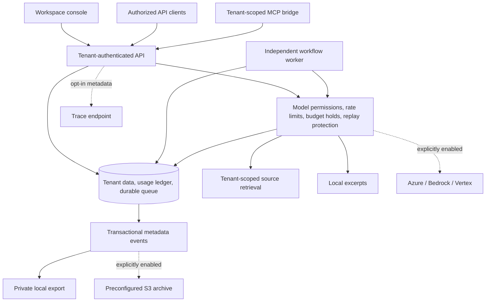

# Integrated platform architecture overview

This page describes the earlier integrated platform. For the independent component portfolio's new event/consumer architecture, see [delivery recovery](demonstrations/event-delivery-recovery.md#architecture-and-trust-boundary). The [independent portfolio architecture and 31 component diagrams](PORTFOLIO_ARCHITECTURE.md) now provide the complete component documentation set.

For request flow, accounting, trust boundaries, and failure behavior, read the [Product & Technical Brief](TECHNICAL_BRIEF.md).

The private platform uses a shared tenant-aware API and model gateway. Its interfaces separate user access, model invocation, durable work, and operational evidence.

## Authorization and accounting

The API derives tenant context from an authenticated key. Callers do not select a tenant through an arbitrary request field. Application queries enforce tenant scoping. Interactive inference and queued work share admission and accounting logic.

A reservation holds estimated cost before remote inference. Successful requests settle recorded costs; uncertain outcomes retain the hold for operator reconciliation. Reusing a successful request's idempotency key returns its stored result. This protects against accidental duplicate calls but does not replace provider billing reconciliation.

## Runtime boundaries

API processes and workflow workers can run independently with PostgreSQL coordinating shared state. SQLite supports local development. Tenant data, outputs, and the usage ledger remain sensitive even when trace export omits content.

Private deployment manifests have been prepared for review, but no production cloud topology or capacity target has been validated. A business deployment still requires identity configuration, network controls, secrets management, database protection, retention policies, restore exercises, and measured load tests.

## Public and private materials

This repository publishes product-level architecture and synthetic examples. The application implementation, deployment credentials, database contents, customer material, and internal release bundles remain outside the showcase. The diagram describes the current foundation and does not imply that every cloud service shown is live.

The v0.3 archive adapter records remote delivery receipts independently from local file exports. It is contract-tested with controlled S3 responses; no live archive deployment or retention policy has been validated. Native workflow clients and opt-in MCP workflow tools use the same admission path. See [integration status](INTEGRATIONS.md).
