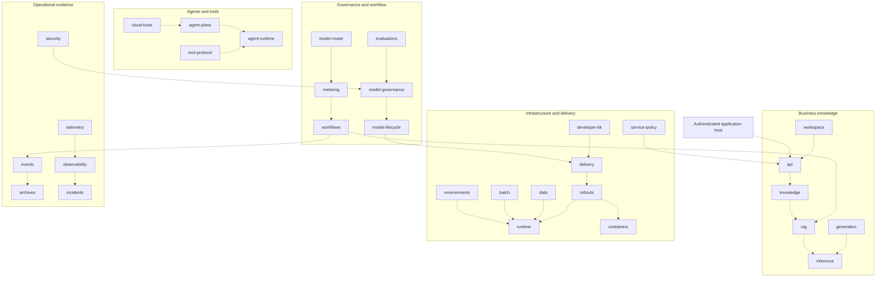

# Independent component portfolio architecture

[All projects](INTEGRATIONS.md) · [Expansion demonstrations](demonstrations/all-component-expansion.md) · [Earlier integrated platform](ARCHITECTURE.md)

**31 component architectures · Original proprietary packages · October 31, 2026**

LuxLeaf separates tenant-facing capabilities, local execution, release decisions, operational evidence and infrastructure planning into independent packages. A repository boundary is an ownership and versioning boundary; it does not require a separate process or cloud service.

## Composition map

Dashed arrows describe intended host composition and compatible responsibilities. Selected paths are exercised by the connected demonstrations; the map does not claim that every arrow is deployed or covered by a cross-component test. The private host must wire callbacks, authenticated context, policy and recovery. No package silently inherits integrations from the earlier combined platform.

## Trust and data flow

The API boundary derives tenant context from a host credential registry and can enforce expiry, role and route scope. Workspace membership and service-policy rules provide separate policy decisions. Knowledge filters tenant documents and optional reader allowlists before retrieval. RAG can require a distinct-source quorum, then validates citation excerpts returned by the inference callback. Current inference is local extractive text; router choices and generation messages do not contact providers.

Workflow and event leases protect local claims with fences and active proof. Unknown outcomes require explicit reconciliation. Metering retains ambiguous usage holds until a trusted operator supplies actual usage and evidence. Event-to-archive writes cross transaction boundaries; reviewed replay relies on the archive’s exact-content deduplication. A database transaction in one component does not make the full composition atomic.

Release governance evaluates artifact-bound review assertions, revocation and optional freshness. Model lifecycle records promotion or reviewed rollback. Delivery binds a reviewed manifest digest to supplied content; rollout observations can be replayed without advancing a proposal twice. Runtime and container packages generate health checks and restricted definitions; environments and batch validate placement constraints. These components do not deploy or switch traffic.

## State and deployment model

Packages expose the LuxLeaf v1 envelope and local Python APIs. The standard runner serializes SQLite JSON state by component and tenant, with bounded request/result and state sizes. This supports reproducible local demonstrations and small host integrations. It is not a distributed queue, production database architecture or measured scaling guarantee.

A production host still needs verified user/workload identity, per-operation authorization, encryption, retention, database recovery, remote adapter contracts, resource quotas and target-specific load tests. Synthetic approval fields and configuration assertions must never be accepted as authority from an end user or model. Telemetry exporters must select the sanitized span rather than the outer envelope containing tenant context.

## Component architecture index

| Architecture and actual evidence | Group | Current expansion |
|---|---|---|
| [luxleaf-workspace](architectures/luxleaf-workspace.md) | Business knowledge | Membership revisions and audit |
| [luxleaf-knowledge](architectures/luxleaf-knowledge.md) | Business knowledge | Document reader restrictions |
| [luxleaf-inference](architectures/luxleaf-inference.md) | Business knowledge | Exact output budgets and passage deduplication |
| [luxleaf-metering](architectures/luxleaf-metering.md) | Governance and workflow | Reviewed unknown-usage reconciliation |
| [luxleaf-workflows](architectures/luxleaf-workflows.md) | Governance and workflow | Active workflow lease renewal |
| [luxleaf-environments](architectures/luxleaf-environments.md) | Infrastructure and delivery | Contained nonoverlapping subnet plans |
| [luxleaf-evaluations](architectures/luxleaf-evaluations.md) | Governance and workflow | Measured retrieval quality gates |
| [luxleaf-model-router](architectures/luxleaf-model-router.md) | Governance and workflow | Latency-aware routing and fallback order |
| [luxleaf-generation](architectures/luxleaf-generation.md) | Business knowledge | Whole-record context budgeting |
| [luxleaf-agent-plans](architectures/luxleaf-agent-plans.md) | Agents and tools | Dependency waves and plan identity |
| [luxleaf-tool-protocol](architectures/luxleaf-tool-protocol.md) | Agents and tools | Bounded local tool batches |
| [luxleaf-cloud-tools](architectures/luxleaf-cloud-tools.md) | Agents and tools | Region constraints and unambiguous resource paths |
| [luxleaf-agent-runtime](architectures/luxleaf-agent-runtime.md) | Agents and tools | Dependency-order enforcement |
| [luxleaf-rag](architectures/luxleaf-rag.md) | Business knowledge | Distinct-source quorum before inference |
| [luxleaf-model-governance](architectures/luxleaf-model-governance.md) | Governance and workflow | Approval freshness and revocation |
| [luxleaf-batch](architectures/luxleaf-batch.md) | Infrastructure and delivery | Exact placement selectors |
| [luxleaf-events](architectures/luxleaf-events.md) | Operational evidence | Managed event lease renewal |
| [luxleaf-rollouts](architectures/luxleaf-rollouts.md) | Infrastructure and delivery | Idempotent rollout observations |
| [luxleaf-runtime](architectures/luxleaf-runtime.md) | Infrastructure and delivery | HTTP readiness and liveness probes |
| [luxleaf-archives](architectures/luxleaf-archives.md) | Operational evidence | Verified archive pagination |
| [luxleaf-data](architectures/luxleaf-data.md) | Infrastructure and delivery | Read-only database inspection |
| [luxleaf-developer-kit](architectures/luxleaf-developer-kit.md) | Infrastructure and delivery | Transitive rebuild planning |
| [luxleaf-api](architectures/luxleaf-api.md) | Business knowledge | Credential expiry and route scopes |
| [luxleaf-service-policy](architectures/luxleaf-service-policy.md) | Infrastructure and delivery | Exact resource-scoped service rules |
| [luxleaf-security](architectures/luxleaf-security.md) | Operational evidence | Posture regression comparison |
| [luxleaf-telemetry](architectures/luxleaf-telemetry.md) | Operational evidence | Explicit pseudonym-key rotation |
| [luxleaf-observability](architectures/luxleaf-observability.md) | Operational evidence | Combined latency and availability objective |
| [luxleaf-incidents](architectures/luxleaf-incidents.md) | Operational evidence | Evidence-backed incident ownership handoff |
| [luxleaf-delivery](architectures/luxleaf-delivery.md) | Infrastructure and delivery | Artifact-bound release decisions |
| [luxleaf-containers](architectures/luxleaf-containers.md) | Infrastructure and delivery | Explicit argv container health checks |
| [luxleaf-model-lifecycle](architectures/luxleaf-model-lifecycle.md) | Governance and workflow | Reviewed rollback to known active candidates |

## What has been demonstrated

All 31 expansion scenarios executed against clean committed checkouts and passed 122 assertions. The source portfolio passed 174 component tests and 14 integration tests. [Read the evidence](demonstrations/all-component-expansion.md). Production capacity, live cloud acceptance and independent security assurance remain unestablished.
