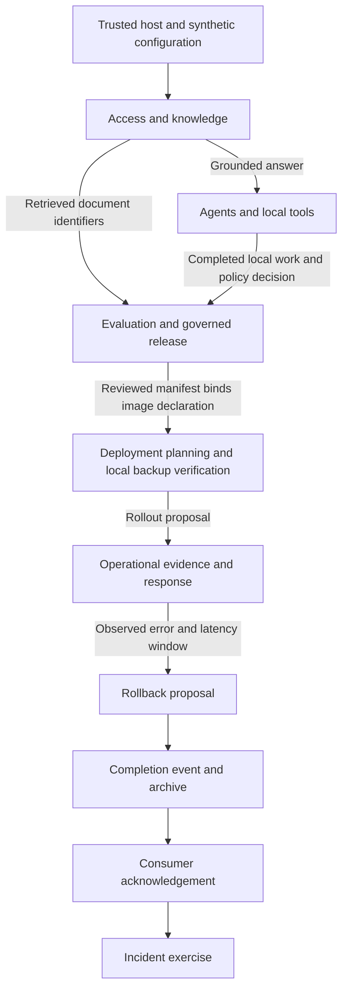
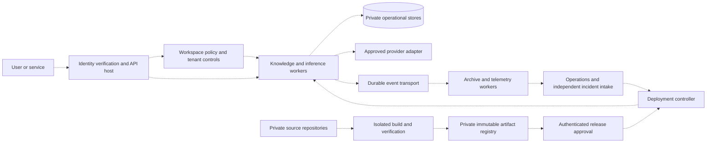

# LuxLeaf system architecture

[Pipeline contracts and gates](SYSTEM_PIPELINES.md) · [31 component architectures](PORTFOLIO_ARCHITECTURE.md) · [Execution evidence](demonstrations/system-pipeline-record.json)

The system comprises 31 independently versioned packages, connected through five pipeline families. Repository boundaries establish ownership and release identity; they do not imply 31 microservices. The current implementation is a local Python composition with separate component stores. The target deployment below is an engineering design, not a provisioned environment.

## Implemented system composition

Developer Kit 0.4.0 compiles explicit dependencies and output references, checks gates, and records metadata receipts. A full-system acceptance run executes 37 stages across all 31 components. It transfers real outputs between stages rather than treating a collection of successful standalone examples as an integrated system.

These solid arrows are exercised by the local acceptance composition. It serializes the five families to test their handoffs. A production query must not wait for a release or incident pipeline; those families need independent triggers and authenticated asynchronous handoffs.

The six-stage durable knowledge coordinator remains one subsystem. It has demonstrated recovery after process exits. The broader 37-stage executor has no durable resume or automatic retry. That distinction is part of the system contract, not an implied inheritance between packages.

## Target deployment and trust boundaries

Dashed arrows and the remote services in this diagram are proposed deployment responsibilities. No provider, registry, cluster, event broker, collector or identity provider was provisioned by this increment.

| Boundary | Required host contract | Present implementation and remaining work |
|---|---|---|
| Public edge → application | Verify credential, derive tenant and actor, enforce route permissions and request bounds | In-process API boundary and membership policies exist; production identity integration and listener remain |
| Application → component | Registered adapter and declared revision; immutable request identity; validate response envelope | New system adapter composition and bounded results; network service authentication remains |
| Retrieval → answer | Tenant and reader filtering; exact citation support; bounded output; current-access recheck on delivery | Local retrieval/inference/RAG and the durable knowledge accessor exist; production search and remote provider adapters remain |
| Worker → accounting | Reserve before spend; settle verified actual cost; preserve ambiguous holds | Local ledger supports these states; paid provider reconciliation and commercial billing remain |
| Worker → tools | Host-owned tool registry, least privilege, validated arguments and explicit effect policy | Local text tools execute; scoped cloud proposals are evaluated but not sent |
| Build → release | Bind exact bytes and image identity to authenticated test/scan reports and independent approvals | Digest checks and policy decisions execute; acceptance flags and reviewers are synthetic, not authenticated CI evidence |
| Event → archive | Persist before acknowledging; exact-content identity; reconcile uncertain writes | Local events and archives implement these contracts; remote transport/sink recovery remains |
| Telemetry → exporter | Export only approved fields, not the outer tenant-bearing envelope | Local span sanitization exists; collector/exporter and operational access policies remain |

## State ownership and consistency

Each component's standard handler owns its component/tenant state. The system acceptance harness uses one disposable SQLite file per component. The Workflows coordinator has a separate journal; the Data recovery exercise uses a separate source and backup. This prevents a shared database file from disguising the absence of a cross-component transaction.

Workspace owns memberships; Knowledge owns reader-scoped documents; Metering owns reservations and settlement; Workflows owns queue claims and its separate coordinator journal; Agent Runtime owns execution records; Model Lifecycle owns candidate history; Events owns consumer receipts; Archives owns its append history; Rollouts owns proposal observations; Incidents owns incident state. Other components are policy, transformation or configuration services even when the standard envelope runner persists empty/local state.

No global transaction, exactly-once arbitrary effect or universal rollback exists. Before-dispatch gate failure is blocked. A handler exception or failed result gate is uncertain because the effect may already have committed. The system stops remaining stages and reports the boundary without exposing exception text. Operators must reconcile earlier effects before any rerun; `SystemPlan.run()` itself is not a durable run registry.

Live user requests, release operations and incident response require separate state machines. In particular, incident intake must remain available when archive delivery fails. The acceptance graph intentionally stops on archive failure; production fallback evidence storage and notification are outstanding work.

## Build, release and environment promotion

1. Pin each component to an exact reviewed commit and numeric package version. Maintain an integration lock for a complete system run; changing an adapter revision changes the plan fingerprint.
2. Run component tests first, then resolve the full private dependency set for cross-component gates. The current repositories' CI tests each package; the system suite is presently verified locally because repository-scoped CI does not automatically have access to other private repositories.
3. Build wheels and source archives from clean commits, install the wheel into an isolated environment, and verify artifact hashes. Package artifacts stay in the existing private release destinations.
4. Produce a content manifest containing the intended image identity. Evaluate retrieval quality and security assertions; bind independent reviews and lifecycle decisions to that exact manifest digest. Changed content must fail final delivery validation.
5. Validate environment placement, resource budgets and restricted runtime definitions. Verify backup readability before rollout planning. These checks currently generate proposals and perform local backup operations; they do not create infrastructure.
6. A future deployment controller must verify workload identity, artifact signatures/attestations and environment-specific approval before applying a proposal. It must record health and capacity measurements and support an audited rollback. None of those checks can be satisfied by a client-provided Boolean.

The acceptance image is a synthetic digest-pinned identifier, not a built image. Its inclusion in a manifest proves content binding within the exercise; it does not prove provenance, vulnerability scanning or registry availability.

## Scaling design and acceptance criteria

| System concern | Proposed next implementation | Required evidence before claiming readiness |
|---|---|---|
| Request throughput | Stateless authenticated API hosts and bounded workers | Measured latency/error curves, saturation behavior and tenant fairness |
| Persistent coordination | Durable journals for agent, release and operations paths with effect-specific recovery | Process interruption at each effect/checkpoint boundary; stale-worker rejection; no duplicate accounting |
| Storage | Select production transactional and document stores; explicit migration/backup contracts | Restore rehearsal, schema compatibility, tenant isolation and retention tests |
| Providers and tools | Host-managed credentials, allowlisted destinations and explicit time/cost limits | Timeout/ambiguous-success reconciliation, usage verification and egress tests |
| Delivery | Cross-repository lock validation and authenticated CI attestations | Changed dependency invalidates downstream evidence; artifact substitution blocked |
| Operations | Independent incident intake, durable fallback sink and notifications | Main archive outage cannot suppress incident creation; tested recovery and escalation |
| Availability | Deployment-specific failure domains and capacity policy | Documented RPO/RTO targets agreed before testing; demonstrated failover and recovery |

No capacity, uptime, compliance, RPO or RTO number is asserted without deployment evidence. Business requirements will determine those targets; sample counts are not service guarantees.

## System-wide roadmap

The next implementation priorities are shared across the portfolio: persist authenticated handoffs and recovery outside the knowledge path; run the complete integration lock in private CI; implement real provider accounting; and add a deployment adapter with independently available operational recovery. Each addition must update its pipeline contract, failure tests, ownership map and public evidence. Expanding one package alone does not complete the system milestone.

Original implementation remains private and proprietary to Michelle L. Wu. Public documentation is governed by the [showcase license](../LICENSE).
