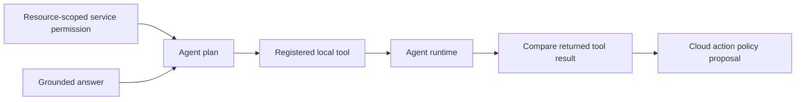
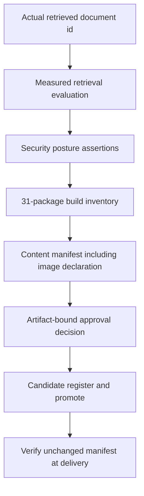
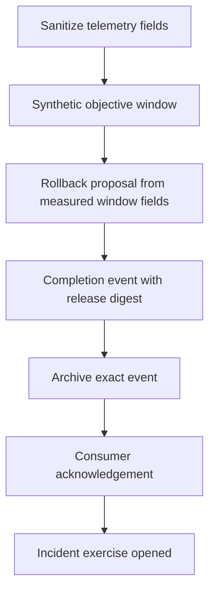

# System pipelines and integration contracts

[System architecture](SYSTEM_ARCHITECTURE.md) · [Component index](PORTFOLIO_ARCHITECTURE.md) · [Sanitized execution record](demonstrations/system-pipeline-record.json)

**Five pipeline families · 31 components · 37 executed stages · Developer Kit 0.4.0**

The system acceptance runner executes explicit output-to-input bindings and fail-closed gates. It calls real local components, keeps their stores separate, verifies a real local backup, and reports only stage metadata and hashes. Identity credentials, reviewer identities, release-check flags, infrastructure posture, capacity, image identity and SLO samples are synthetic fixtures. No live cloud calls occur.

## 1. Access and knowledge

**Trigger:** an authenticated host supplies tenant, actor and a policy question. The exercise seeds membership and documents beforehand; it does not implement production onboarding.

**Handoffs:** reader-scoped citations feed both prompt preparation and local inference. RAG validates the inference result against the retrieved excerpts. Workflow completion precedes settlement using the actual local result's zero cost. Prompt preparation does not invoke a provider.

**Failure gates:** absent workspace access or missing readable evidence stops inference; wrong result identity is rejected by the host adapter. A failed downstream operation does not silently undo a credit hold. The separate durable knowledge flow supports reviewed recovery and current-access checks for stored answers; this system acceptance executor does not itself implement durable resume or a user-facing answer cache.

## 2. Agents and tools

**Trigger:** the permitted local work consumes the grounded answer from pipeline 1. The plan is bounded and dependency ordered; the runtime result must match the direct registered-tool result.

**Failure gates:** default-deny service policy stops the plan and all following stages. Only local text functions execute. Cloud Tools checks an inventory proposal's scope but does not contact a cloud. LuxLeaf Tool Protocol is its own local contract; this is not an assertion of MCP compatibility.

**Production boundary:** a network tool adapter requires authenticated workload identity, validated destinations, explicit effect idempotency, timeout handling and a durable recovery policy before it can execute remote actions.

## 3. Governed release

**Trigger:** a synthetic candidate bundle is evaluated against the retrieval observed in pipeline 1. All 31 packages are independently buildable in the inventory; runtime call edges are not falsely presented as packaging dependencies.

**Handoffs:** the same manifest digest passes through governance, lifecycle promotion and final delivery. The declared deployment image must equal the image text inside the reviewed bundle. Content changed after review fails final delivery.

**Failure gates:** failed retrieval quality, asserted security controls, declared release checks or image binding prevents deployment stages. Reviewers and release-test flags in this exercise are synthetic. A real release requires authenticated evidence and reviews bound to the actual artifacts; a Boolean field supplied by a user is not proof of tests or approval.

## 4. Deployment planning and data recovery

**Handoffs:** runtime, container and rollout definitions consume the image declaration included in the reviewed manifest. Before the rollout proposal starts, the Data adapter migrates a disposable SQLite database, writes a synthetic row, creates a backup, reads it and checks integrity.

**Failure gates:** deferred placement, backup failure or invalid configuration stops rollout planning. Environment, batch, runtime and container packages return plans, not deployed resources. No image is pulled, container started, cluster changed or traffic routed.

**Production boundary:** migration compatibility, real restore targets, private networks, secret injection, deployment credentials, probes and measured rollout observations remain target-specific work.

## 5. Operations, evidence and response

**Handoffs:** the telemetry sanitizer removes the question content. The Observability component's count, errors and p95 feed Rollouts, rather than duplicating a second unrelated observation. The completion event includes the verified release digest and rollback decision. Archives receives the exact event; only then does its dedicated consumer acknowledge delivery.

**Failure gates:** archive failure leaves the event pending. The incident stage is gated by an objective breach. The exercise opens a local incident without sending a notification. Production incident intake must run independently of the primary archive; an archive outage must not suppress operational response.

## Execution and recovery contract

The shared compiler validates missing dependencies, cycles, adapters and reference shapes before execution. It orders stages deterministically and binds declared adapter revisions into the plan hash. References add dependencies; an explicit ordering edge alone does not imply data transfer.

Before-dispatch failures are blocked. Exceptions and failed postconditions are uncertain because effects may already exist. Both stop all remaining stages. Receipt metadata includes the exact boundary and unstarted stages, never raw exception text or output values. Raw outputs remain a sensitive host result; hashes are not encryption.

The executor is sequential and has no persistent run registry, automatic retries, compensation or distributed scheduling. Starting it again can repeat effects. The durable knowledge coordinator remains separate and its crash guarantees cannot be generalized to these 37 stages. Hosts must reconcile ambiguous effects before rerunning and enforce current authorization before returning sensitive results.

## Acceptance evidence

The recorded run completes all 37 stages and covers all 31 components. Sixteen assertions verify coverage, output handoffs, artifact binding, backup recovery, rollback input, archive delivery, settlement and four downstream-blocking scenarios. The maintained integration suite also checks reader denial, changed content after review, backup failure and archive failure before acknowledgement.

The publication record contains exact clean component commits, the compiled graph, successful stage receipts and sanitized failure summaries. Source and packages remain private. These checks establish local integration behavior, not cloud deployment, production throughput or regulatory assurance.

## Complete component-to-pipeline map

| Component architecture | Pipeline families | Executed stages |
|---|---|---|
| [luxleaf-agent-plans](architectures/luxleaf-agent-plans.md) | agent-tools | agent-plan |
| [luxleaf-agent-runtime](architectures/luxleaf-agent-runtime.md) | agent-tools | agent-run |
| [luxleaf-api](architectures/luxleaf-api.md) | access-knowledge | entry |
| [luxleaf-archives](architectures/luxleaf-archives.md) | operations-response | archive |
| [luxleaf-batch](architectures/luxleaf-batch.md) | deployment-recovery | placement |
| [luxleaf-cloud-tools](architectures/luxleaf-cloud-tools.md) | agent-tools | cloud-policy |
| [luxleaf-containers](architectures/luxleaf-containers.md) | deployment-recovery | container |
| [luxleaf-data](architectures/luxleaf-data.md) | deployment-recovery | restore |
| [luxleaf-delivery](architectures/luxleaf-delivery.md) | governed-release | bundle, release |
| [luxleaf-developer-kit](architectures/luxleaf-developer-kit.md) | governed-release | build-order |
| [luxleaf-environments](architectures/luxleaf-environments.md) | deployment-recovery | environment |
| [luxleaf-evaluations](architectures/luxleaf-evaluations.md) | governed-release | quality |
| [luxleaf-events](architectures/luxleaf-events.md) | operations-response | event, pending, acknowledge |
| [luxleaf-generation](architectures/luxleaf-generation.md) | access-knowledge | prompt |
| [luxleaf-incidents](architectures/luxleaf-incidents.md) | operations-response | incident |
| [luxleaf-inference](architectures/luxleaf-inference.md) | access-knowledge | infer |
| [luxleaf-knowledge](architectures/luxleaf-knowledge.md) | access-knowledge | retrieve |
| [luxleaf-metering](architectures/luxleaf-metering.md) | access-knowledge | reserve, settle |
| [luxleaf-model-governance](architectures/luxleaf-model-governance.md) | governed-release | approval |
| [luxleaf-model-lifecycle](architectures/luxleaf-model-lifecycle.md) | governed-release | candidate, promote |
| [luxleaf-model-router](architectures/luxleaf-model-router.md) | access-knowledge | route |
| [luxleaf-observability](architectures/luxleaf-observability.md) | operations-response | objective |
| [luxleaf-rag](architectures/luxleaf-rag.md) | access-knowledge | ground |
| [luxleaf-rollouts](architectures/luxleaf-rollouts.md) | deployment-recovery, operations-response | rollout, rollback |
| [luxleaf-runtime](architectures/luxleaf-runtime.md) | deployment-recovery | runtime |
| [luxleaf-security](architectures/luxleaf-security.md) | governed-release | posture |
| [luxleaf-service-policy](architectures/luxleaf-service-policy.md) | agent-tools | agent-policy |
| [luxleaf-telemetry](architectures/luxleaf-telemetry.md) | operations-response | span |
| [luxleaf-tool-protocol](architectures/luxleaf-tool-protocol.md) | agent-tools | tool-check |
| [luxleaf-workflows](architectures/luxleaf-workflows.md) | access-knowledge | workflow |
| [luxleaf-workspace](architectures/luxleaf-workspace.md) | access-knowledge | access |
