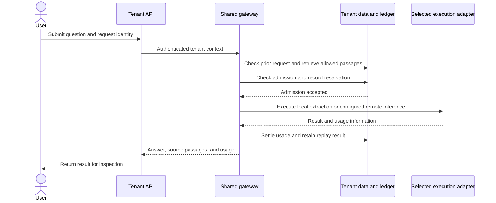
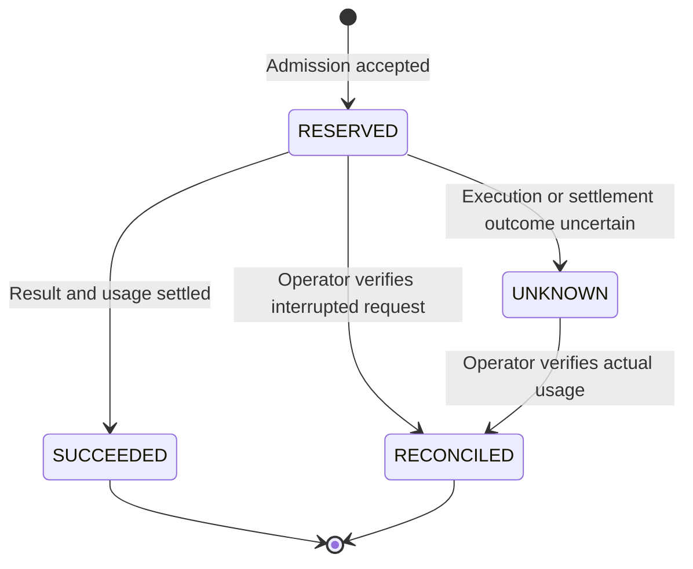

# LuxLeaf AI — Product and Technical Brief

**Historical platform snapshot:** this brief describes v0.2. For the v0.3 protocol, client, tool and archive additions, see the [integration roadmap](INTEGRATIONS.md). Its original evidence dates and limitations are retained below.

**Document version:** 1.0 · **Platform described:** private v0.2 development foundation · **Evidence date:** October 30, 2026

**Purpose:** explain what LuxLeaf does, how its main boundaries behave, what has been tested, and what must be established before a business deployment.

This is a public design and evaluation brief. It contains no application source, credentials, customer data, or deployment instructions. The private platform is a development foundation; a public hosted service and production readiness are not being announced.

## Reading guide

| Reader | Suggested sections |
|---|---|
| Business or product evaluator | [Purpose](#purpose-and-initial-fit), [capability status](#capability-status), [business evaluation](#business-evaluation) |
| Technical evaluator | [Request flow](#request-flow), [accounting](#usage-and-cost-accounting), [failure behavior](#failure-behavior) |
| Security or operations reviewer | [Trust boundaries](#trust-boundaries), [data lifecycle](#data-lifecycle), [operating responsibilities](#operating-responsibilities) |
| Potential collaborator | [Evidence](#validation-evidence), [release gates](#proposed-release-gates), [open decisions](#open-decisions) |

## Purpose and initial fit

Business AI workflows often involve several distinct decisions: which documents a person may access, which model may receive those documents, how a request is charged, and what should happen when a job is interrupted. LuxLeaf's design places those decisions around a common tenant-aware API and inference gateway.

The initial supported task is a question over authorized text documents. A user can inspect retrieved passages, request an answer through a configured provider, or submit the same class of task as a durable workflow. Tool clients use a narrow MCP interface to that same application boundary.

**Illustrative fits** include internal handbook questions, onboarding guidance, and repeatable questions over approved project documents. These are proposed evaluation scenarios, not a list of deployed customer solutions.

A useful first evaluation should involve a small authorized document set, a named document owner, realistic questions with known answers, and a person responsible for reviewing the output. Workloads involving regulated decisions, arbitrary code execution, or unbounded document ingestion require capabilities and validation beyond the current foundation.

## Capability status

The following labels describe different kinds of evidence:

- **Implemented:** behavior exists in the private development foundation.
- **Contract-tested:** an adapter has been exercised with controlled responses, without proving a live provider deployment.
- **Prepared:** an artifact exists for review, but its target environment has not been validated.
- **Planned:** additional implementation or validation is required.

| Area | Current status | Material boundary |
|---|---|---|
| Tenant access | Implemented and tested with administrator/member API keys | Individual-user SSO, membership lifecycle, MFA, and expiring service keys are planned |
| Knowledge retrieval | Implemented for text and Markdown with source passages | Bounded lexical retrieval; no PDF/OCR pipeline or production hybrid index |
| Local answers | Implemented | Returns excerpts rather than an LLM-generated answer |
| Cloud inference | Azure, Bedrock, and Vertex adapters implemented and contract-tested | Credentials, model availability, data boundary, pricing, and live behavior need deployment validation |
| Usage governance | Implemented and tested | Reservations and recorded token costs are not invoices or a guaranteed provider spending cap |
| Durable workflows | Approved knowledge-query operation implemented and tested | No arbitrary uploaded code, general workflow engine, or automatic crash recovery |
| MCP access | Narrow tenant-scoped bridge implemented and protocol-tested | External host integration and the host's other tools are outside the test result |
| Operational evidence | Counts, opt-in metadata traces, and local event export implemented | No measured SLOs, remote immutable archive, or validated external collector delivery |
| Deployment preparation | Container and private deployment artifacts prepared | Production topology, Linux runtime, restore behavior, and capacity remain unverified |

## Actors and authority

A tenant represents a workspace boundary. The current design grants document access across that tenant, rather than assigning permissions to individual documents.

| Actor | Current responsibility or access | Important limit |
|---|---|---|
| Tenant member | Ask questions and use authorized knowledge/workflow functions | Membership does not grant document administration or usage administration |
| Tenant administrator | Manage tenant documents and keys; inspect tenant usage and operational records | No access to another tenant is granted by this role |
| Platform operator | Configure deployments, tenant policy, and recovery operations | This is a trusted operational role, not a public administrative endpoint |
| Workflow worker | Execute the approved queued operation using the submitter's tenant context | Rechecks whether the submitting credential and tenant remain active before execution |
| MCP host | Invoke exposed tools through a configured tenant credential | Tool descriptions and annotations do not replace API authorization |
| Model provider | Process content intentionally sent for a remote request | Provider-side retention, service terms, permissions, and charges are separate deployment considerations |

Revocation and suspension affect subsequent authorization checks. They cannot be assumed to retract content already sent to a provider or abort an operation already in flight. An individual-user identity system and finer document permissions are important additions for broader team use.

## Request flow

The diagram describes the normal path for a **new** interactive knowledge request. Validation failures or admission failures return without invoking the model. A successful replay follows the separate behavior described below.

The provider destination is configured by the operator. A tenant caller selects an allowed adapter rather than submitting an arbitrary destination URL. Remote execution requires both server configuration and tenant permission. MCP adds its own explicit remote-call setting, while continuing to rely on the API's controls.

**Data boundary:** remote mode sends the question and retrieved passages to the selected provider. Local extraction avoids that model-provider transmission. Optional telemetry is a separate outbound integration and should be evaluated independently.

**Quality boundary:** retrieved citations identify the passages supplied as evidence. They do not establish that a generated answer is accurate, complete, or supported by every cited passage. Local mode reports missing evidence when no matching passage is found. A remote generated response still needs evaluation and review, including when evidence is weak or absent.

## Usage and cost accounting

Three quantities help explain admission:

- **Budget:** the configured cumulative tenant credit ceiling.
- **Settled usage:** the cost recorded for completed or reconciled requests.
- **Held reservations:** estimated cost retained for requests that have not settled.

Conceptually, available credit is the budget minus settled usage and held reservations. A new request must fit the admission checks before inference proceeds. Prices are configured and versioned; token costs are recorded using the request's pricing snapshot.

### Illustrative reservation example

These are invented amounts explaining the accounting behavior, not model prices or a product quote.

| Point in time | Budget | Settled usage | Held reservations | Available credit |
|---|---:|---:|---:|---:|
| Before a new request | $100 | $20 | $30 | $50 |
| New request reserves $40 | $100 | $20 | $70 | $10 |
| New request settles at $35 | $100 | $55 | $30 | $15 |

If the new request's outcome becomes uncertain, its $40 remains held pending reconciliation. It is not released merely because the client did not receive an answer.

A reservation is an estimate. If verified actual usage exceeds it, the system records the actual cost, which can exceed the configured credit ceiling. Provider-specific fees, discounts, cached-input pricing, taxes, storage charges, and invoice reconciliation are outside this model. Current budgets are cumulative, not automatically reset monthly subscriptions.

### Request identity and retries

An idempotency key identifies one request attempt within a tenant. Repeating a successful request with the same payload returns its stored result without invoking the model again. Reusing the key for a different payload is rejected. Pending or uncertain requests are not automatically re-executed.

A replay can return earlier retrieved passages even if documents have since changed or been deleted. A genuinely new retrieval needs a new request identity. That is distinct from retrying an uncertain transport outcome: starting a fresh attempt in that situation could duplicate billable work.

A process crash can leave a request in `RESERVED`. Recovery requires confirming that the original caller cannot later complete, then reconciling the outcome. `RECONCILED` does not mean the original answer is available for a successful replay. This design favors preserving uncertainty over silently repeating potentially charged work.

## Failure behavior

| Situation | Current behavior | Remaining responsibility |
|---|---|---|
| Missing, revoked, or inactive credentials | API access is rejected at authentication | Rotate compromised credentials and review related access |
| Model unavailable to the deployment or disallowed for the tenant | Inference is not admitted | Correct configuration or tenant policy through authorized administration |
| Insufficient available credit or inference rate limit reached | New inference admission is rejected | Decide whether to wait, change the workload, or adjust policy |
| Repeated successful request with the same payload | Stored result is returned | Use a new identity only when intentionally requesting new work |
| Same request identity with a changed payload | Request is rejected | Correct client request tracking |
| Provider timeout or uncertain settlement | Hold is retained; outcome requires review | Establish whether the provider executed or billed before reconciling |
| Worker exits during a job | Persistent state can remain unfinished | Stop/identify the original executor, inspect usage, and recover explicitly |
| Event file written before export acknowledgement | A retry recognizes matching content and acknowledges it | Keep the destination durable and access-controlled |
| Existing export file conflicts with its event | Export fails without acknowledging that event | Investigate the mismatch instead of overwriting evidence |
| Application database unavailable | Readiness fails and database-dependent work cannot proceed | Restore database availability and assess interrupted work |

No automatic provider failover or paid retry policy is implemented. Introducing either would require a clear definition of which outcomes can be retried, how duplicate execution is prevented, and how charges are reconciled.

## Durable workflows and cancellation

The queue supports a known knowledge-query operation. Submission records work for a separate worker; it does not execute arbitrary files, shell commands, or caller-supplied workflow URLs.

A worker claims a queued job and checks the submitting identity before using the shared gateway. Submission does not guarantee that later execution will be permitted: credentials, tenant state, provider configuration, and available credit can change between those points.

Cancellation has two meanings:

- A job canceled while it is still queued does not begin execution.
- A job already running may have an outstanding provider call. Cancellation can suppress its workflow output when it finishes, but it does not guarantee that provider computation stops or that charges disappear.

The gateway's stored replay result may remain even when workflow output is suppressed. Cancellation is therefore not a data-deletion mechanism. Worker leases, health signals, and automated orphan-job recovery remain planned work. General scientific workflow execution and full GA4GH WES conformance are not claimed.

## Trust boundaries

These are boundaries to assess, not assertions that all associated threats have been eliminated.

| Boundary | Existing control | Limitation and next validation |
|---|---|---|
| Client to tenant API | Credential-derived tenant context and role checks | Individual-user authentication, lifecycle controls, and edge protection need expansion |
| Tenant to stored knowledge | Tenant-scoped application queries | Database-enforced isolation and per-document permissions remain future defense layers |
| Retrieved document to model | Sources are treated as untrusted input; the inference call exposes no execution tools | Prompt injection and misleading content can still influence generated text |
| Gateway to provider | Operator-configured destinations, explicit enablement, and tenant model permission | Live identity, residency, retention, and accounting must be checked per deployment |
| MCP host to application | Narrow tools use a tenant credential and the same API boundary | A host can have unrelated tools and policies; LuxLeaf does not secure the entire host |
| Application to trace endpoint | Opt-in export with a restricted metadata schema | Collector access, transport configuration, retention, and host logs need separate review |
| Database event to exported file | Transactional event creation and stable event identity | Local files are not an immutable remote archive; loss after acknowledgement needs backup recovery |

No guarantee is made that prompt separation defeats prompt injection. A grounded answer should be evaluated for relevance, source support, uncertainty, and the consequence of being wrong. External actions based on a generated answer would need an additional policy and approval design.

## Data lifecycle

Content minimization in traces does not make the application stateless. Several different records can contain or refer to the same business information.

| Data category | Why it exists | Lifecycle implication |
|---|---|---|
| Documents and searchable passages | Support retrieval within a tenant | Document deletion removes the searchable source material |
| Workflow parameters and outputs | Support durable execution and result inspection | Questions and answers can remain after the source document is removed |
| Successful request replay records | Prevent duplicate inference and return prior results | Earlier source passages or answers can survive source deletion |
| Usage and audit records | Support accounting, diagnosis, and operator review | Metadata remains sensitive even when it excludes document content |
| Exported events | Preserve an operational event stream outside the database | Destination permissions, retention, backup, and delivery recovery are separate concerns |
| Provider-side records | May arise when remote inference is enabled | Their handling depends on the configured provider service and applicable arrangement |
| Database backups | Enable recovery | Retention and deletion policy must address backup copies as well as active storage |

Comprehensive retention enforcement and subject-data deletion are not implemented. A business deployment must define what is retained, by whom, for how long, and how deletion interacts with replay, audit, backups, and provider records. Transport encryption, storage encryption, and secret management are deployment responsibilities; this brief does not claim they have been validated in a production environment.

## Operating responsibilities

The following are **proposed responsibilities for a future deployment**, not a claim that a staffed service or support commitment already exists.

| Responsibility | Decision or evidence to maintain |
|---|---|
| Product owner | Initial workflow, acceptable output quality, and consequences of incorrect answers |
| Tenant administrator | Authorized document sources, membership policy, and workspace access review |
| Platform operator | Deployment identity, provider configuration, rate cards, capacity, upgrades, and recovery |
| Security owner | Threat assessment, credential incidents, logging boundaries, and access review |
| Data owner | Residency, retention, deletion, and permitted provider transmission |
| Release owner | Validation results, known limitations, staging acceptance, and rollback decision |

A single person may hold multiple responsibilities in an early evaluation, but the decisions should still be explicit. No availability target, response-time promise, recovery objective, or support SLA is established by this document.

## Scale assumptions and design tradeoffs

The application is structured so API processes and workers can run independently with PostgreSQL coordinating shared state. That separation is a basis for evaluation, not evidence of a specific throughput or tenant capacity.

| Current choice | Benefit | Cost or reason to revisit |
|---|---|---|
| Shared relational accounting and queue state | Keeps admission, usage, and durable work coordinated | Database contention and connection capacity require measurement |
| Bounded lexical retrieval | Gives an inspectable local path with limited infrastructure | It scans tenant content and does not establish large-corpus relevance or latency |
| One gateway for questions and workflows | Reduces duplicated policy behavior | Gateway changes affect multiple interfaces and require regression testing |
| Uncertain outcomes retain their reservation | Avoids silently treating possibly charged work as free | Operators must reconcile unresolved requests |
| No automatic paid failover | Keeps retry behavior explicit | Availability depends on the selected provider and requires manual response today |
| Local event export first | Makes the durable acknowledgement boundary testable | Remote delivery, immutability, and long-term retention are additional work |

A capacity evaluation should measure tenant and document counts, concurrent admissions, query size, queue age, database wait time, provider latency, and failure rates under representative traffic. Numeric targets should be agreed before the test and reported with workload assumptions. No benchmark should be inferred from the unit-test count.

## Validation evidence

The private v0.2 suite recorded **57 passing tests with SQLite and 57 with PostgreSQL 14.20** on October 30, 2026, using macOS arm64 and Python 3.14.3. Those are two database runs of the same suite, not 114 distinct tests.

Coverage includes tenant separation, role enforcement, revocation, request replay, concurrent admission, held-budget behavior, workflow cancellation/recovery, synthetic provider contracts, MCP protocol access, event-export recovery, and trace-content restrictions. A small synthetic retrieval check includes three positive cases and one no-evidence case.

The tests establish observed behavior for those cases. They do not establish Linux runtime compatibility, live cloud acceptance, external MCP-host behavior, security against every adversary, independent assurance, regulatory compliance, backup restoration, or business-scale performance.

**Public verification is narrower:** this repository's CI checks allowlisted showcase files, recognizable secret patterns, local links, and assets. It neither distributes nor executes the private platform suite. Full scope is recorded in [VALIDATION.md](VALIDATION.md).

## Proposed release gates

Each gate below describes evidence needed to progress. None is marked complete merely because a template, diagram, or plan exists.

| Gate | Minimum evidence to review | Current position |
|---|---|---|
| Reproducible staging | Built and scanned target-platform image; successful deployment; documented environment and rollback | Deployment artifacts prepared; target runtime unverified |
| Identity and tenant access | Real user/membership lifecycle; credential rotation; negative authorization tests across interfaces | API-key tenant controls tested; individual-user lifecycle planned |
| Provider acceptance | Synthetic live requests using deployment identity; observed token accounting; data-boundary and regional configuration review | Adapter contracts mocked; live acceptance pending |
| Knowledge quality | Representative, authorized evaluation set; relevance, source support, no-evidence, and injection-resilience review | Tiny lexical smoke set only |
| Recovery and evidence | Restore exercise; interrupted-job exercise; reconciled uncertain charge; durable archive delivery/retention checks | Local failure behavior tested; operational exercises pending |
| Capacity and service objectives | Agreed workload and latency/error targets; repeatable load results; alert and overload behavior | Targets and measurements not established |
| Commercial operation | Customer terms, support responsibilities, billing reconciliation, onboarding and offboarding evidence | Planned; no commercial service commitment in this showcase |

A staging success should not bypass access or data-lifecycle decisions. A paid deployment should not infer billing correctness solely from token accounting. The [roadmap](ROADMAP.md) groups the work; these gates describe how a reviewer could assess it.

## Business evaluation

A useful pilot proposal would answer six questions before adding infrastructure:

1. **Task:** What recurring question or workflow is costly or difficult today?
2. **Evidence:** Which documents are authoritative, and who may authorize their use?
3. **Access:** Who should see the documents, answers, and usage records?
4. **Quality:** What does a correct, supported answer look like, and when must the system abstain?
5. **Operation:** Who investigates a failed job, uncertain charge, or suspected exposure?
6. **Success:** Which baseline and measurements would show that the workflow improved?

Possible measurements include supported-answer rate on a reviewed question set, time needed to locate evidence, unresolved-job age, and verified cost per completed task. These are candidate evaluation measures, not published product performance numbers. Include unsuccessful cases and human review effort rather than reporting only successful demonstrations.

## Open decisions

- Which initial workflow and customer profile should shape the next development stage?
- What residency, retention, and data-classification constraints apply to the intended documents?
- Are tenant-wide permissions sufficient, or must individual documents have narrower access?
- Which provider and primary deployment environment should receive the first live acceptance test?
- What latency, recovery, and support expectations are realistic for the intended workload?
- Which costs must be reconciled before introducing customer billing?

These decisions should be resolved against a concrete use case. Adding more provider samples alone does not resolve them.

## Ownership, references, and change policy

Michelle L. Wu owns the original LuxLeaf materials subject to applicable third-party rights. The public [showcase license](../LICENSE) governs this repository's original materials; it grants no access to the private application. Public engineering references remain separately owned and licensed. The [reference register](REFERENCES.md) identifies reviewed projects and commits without implying endorsement or feature equivalence.

Update this brief when a capability changes, a new validation result is available, or a release gate is satisfied. Keep historical evidence dates and distinguish planned work from observed results. Sensitive reports belong in the private route described in [SECURITY.md](../SECURITY.md), not in public examples or issues.
