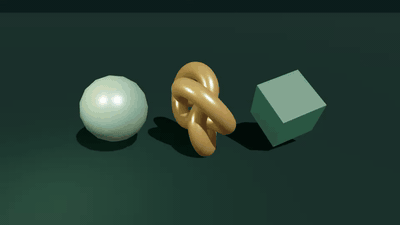
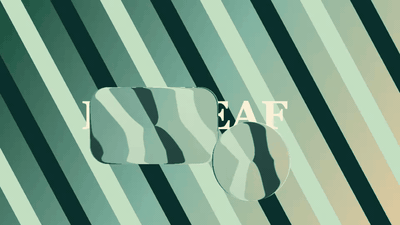

# Demo videos for all four visual products

Each product now has a dedicated recorded demonstration. The animated previews below link to real canvas recordings; the repositories include the source composition and playback/export instructions. There is no soundtrack or generated footage.

| Product | Full video | What it demonstrates |
|---|---|---|
| Scene Kit | [Watch MP4](../assets/visual-products/scene-kit-motion.mp4) | Animated geometry, materials, lighting and shadows |
| Glass UI | [Watch MP4](../assets/visual-products/glass-ui-motion.mp4) | Moving glass lenses with backdrop refraction |
| Gradient Studio | [Three films](https://github.com/Zontafor/luxleaf-gradient-studio#motion-videos) | Emerald Tide, Orchid Orbit and Copper Dawn |
| Metal Mark | [AULIN MP4](https://github.com/Zontafor/luxleaf-metal-mark/blob/main/docs/media/aulin-demo.mp4) · [SentiLeaf MP4](../assets/visual-products/sentileaf-liquid-metal.mp4) | Selected AULIN chrome motion and a transparent-logo workflow |

## Scene Kit

[Source and reproduction](https://github.com/Zontafor/luxleaf-scene-kit/tree/main/.luxleaf/motion) · [Capture evidence](../assets/visual-products/scene-kit-motion.json). 10.03 seconds, 960 × 540.

## Glass UI

[Source and reproduction](https://github.com/Zontafor/luxleaf-glass-ui/tree/main/.luxleaf/motion) · [Capture evidence](../assets/visual-products/glass-ui-motion.json). 9.8 seconds, 960 × 540. The demonstration composites actual glass-shader canvases over an original backdrop; it is not a claim of arbitrary-page capture coverage.

## Gradient Studio

[All three palette films and reproduction](https://github.com/Zontafor/luxleaf-gradient-studio#motion-videos).

## Metal Mark — AULIN and SentiLeaf

[AULIN artwork modes and reproduction](https://github.com/Zontafor/luxleaf-metal-mark/blob/main/docs/AULIN.md) · [SentiLeaf demo](demonstrations/sentileaf-liquid-metal.md).

The lead AULIN film preserves the user-selected live editor settings: cutout mode, gradient backdrop, Refraction 0.015, Edge 0.661, Pattern Blur 0.05, Liquify 0.4, Speed 1 and Pattern Scale 10. Choose **AULIN demo** in the editor to restore them. The [full-surface comparison](https://github.com/Zontafor/luxleaf-metal-mark/blob/main/docs/media/aulin-full-surface.mp4) remains available. Luminance supplies artistic relief, not reconstructed physical depth, and motion is procedural. This update passed 40 automated tests and 29 local browser checks. These counts are specific to Metal Mark, not a combined certification of every product.

GitHub may offer a download button for MP4 files. The GIFs are short previews and are not guaranteed seamless loops. Public source visibility does not change the applicable licenses or publish new registry packages. [Product status and architecture](VISUAL_PRODUCTS.md).
