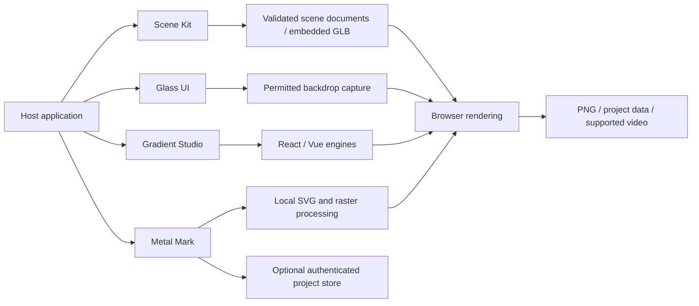

# LuxLeaf visual products — development status

All four implementation repositories are **public again**, with their latest development source and demonstrations. This public showcase presents approved recordings and documentation. No new package is published by this update. Original LuxLeaf additions remain proprietary to Michelle L. Wu; licensed foundations retain their authorship and license notices.

## Public repositories

| Product | Current source and demonstrations |
|---|---|
| Scene Kit | [Zontafor/luxleaf-scene-kit](https://github.com/Zontafor/luxleaf-scene-kit) |
| Glass UI | [Zontafor/luxleaf-glass-ui](https://github.com/Zontafor/luxleaf-glass-ui) |
| Gradient Studio | [Zontafor/luxleaf-gradient-studio](https://github.com/Zontafor/luxleaf-gradient-studio) — recorded gradient films |
| Metal Mark | [Zontafor/luxleaf-metal-mark](https://github.com/Zontafor/luxleaf-metal-mark) — SentiLeaf editor and film |

Public visibility does not change the stated license terms or publish a new registry version. The backend/system implementation repositories remain private.

## Current SentiLeaf demonstration

[Watch the full film and inspect the fix](demonstrations/sentileaf-liquid-metal.md). The default metal editor now uses the supplied SentiLeaf logo, removes its flat backdrop, fits the artwork and records the selected preview background. Local validation: 30 automated tests and 25 browser checks. The current development API is not in the earlier 0.2.0 registry package.

## Earlier released workbenches

The following screenshots and test counts describe the earlier v0.2 workbenches. They are retained as historical demonstrations, not current distribution or public-access claims. Current development includes the restored licensed source trees and further independent metal-renderer development. Repository links below provide current source. Historical releases remain separate from the current development implementation.

## Scene Kit

The complete Fiber API, native entry point, test renderer and lint integration sit alongside LuxLeaf scene documents, model cloning, asset leases, animation playback, adaptive quality and PNG export. The local model importer accepts embedded GLB resources and disposes owned resources when replaced. The **228-file pinned foundation tree** preserves the implementation, tests, examples and documentation with hash verification.

## Glass UI

A real captured-backdrop shader feeds nested optical buttons. Validated controls, keyboard and disabled behavior, React integration, capture-root coordinates and resource cleanup complement the CSS components. The **13-file MIT reference** is preserved. Version 0.2.1 corrects capture alignment and zero-blur rendering; its stronger browser test checks backdrop colors as well as output pixels.

## Gradient Studio

React runs from the pinned 2.4.24 source; Vue uses the full 0.1.0 package. All twelve geometry/shader-family combinations are exercised on a real GPU. The studio adds strict presets, undo/redo, interpolation, URL sharing and PNG export. Separate Framer and Figma adapters are present, with actual editor-host verification still outstanding. The **606-file reference tree** preserves the broader packages, apps, integration sources, shaders and tests.

## Metal Mark

Original LuxLeaf code processes local SVG, PNG and WebP into distance-field bevels and normals. The studio supports directional reflections, PNG/WebM export, embedded-logo projects, undo/redo and bounded share links. An authenticated SQLite adapter supports project storage, expiry and deletion. No Paper Design implementation, shader or asset was copied; exact compatibility with that restricted product is not claimed.

## Architecture

Each repository includes architecture, capability, validation and provenance documentation. Preserved reference files are separate from LuxLeaf extensions. The optional project store is a single-process adapter; host tenancy, rate limits, distributed storage, HTTPS and operating budgets remain application responsibilities.

## Recorded verification — November 1, 2026

| Package | Unit/integration tests | Expanded browser assertions |
|---|---:|---:|
| Scene Kit | 18 | 6 |
| Glass UI | 13 | 11 |
| Gradient Studio | 12 | 28 |
| Metal Mark | 16 | 10 |
| **Total** | **59** | **55** |

The browser assertions were run against production previews in the Codex in-app Chromium surface. They include actual model loading, GPU output, DOM capture, SVG rejection, PNG export, WebM recording and cleanup. They are separate from automated GitHub CI. Package verification checks exported files and imports extracted archives; publishing additionally tests a fresh registry installation.

Remaining validation includes native devices, Figma/Framer editor hosts, a broad browser/GPU/codec matrix, accessibility review, performance budgets and independent security review. Preserving reference source does not prove every upstream test or application has been recreated.

These products complement the existing [system architecture](SYSTEM_ARCHITECTURE.md) and [pipeline families](SYSTEM_PIPELINES.md). The 31-component backend/system catalog and its recorded counts remain separate.
