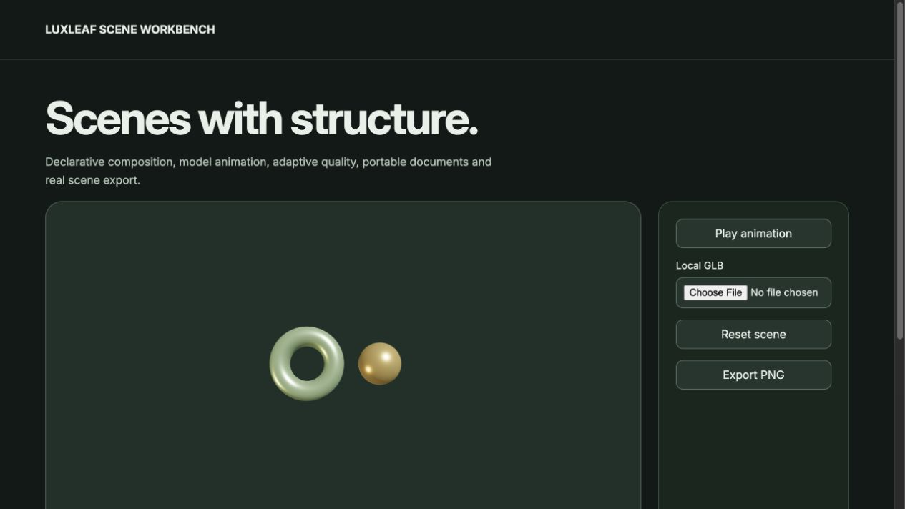
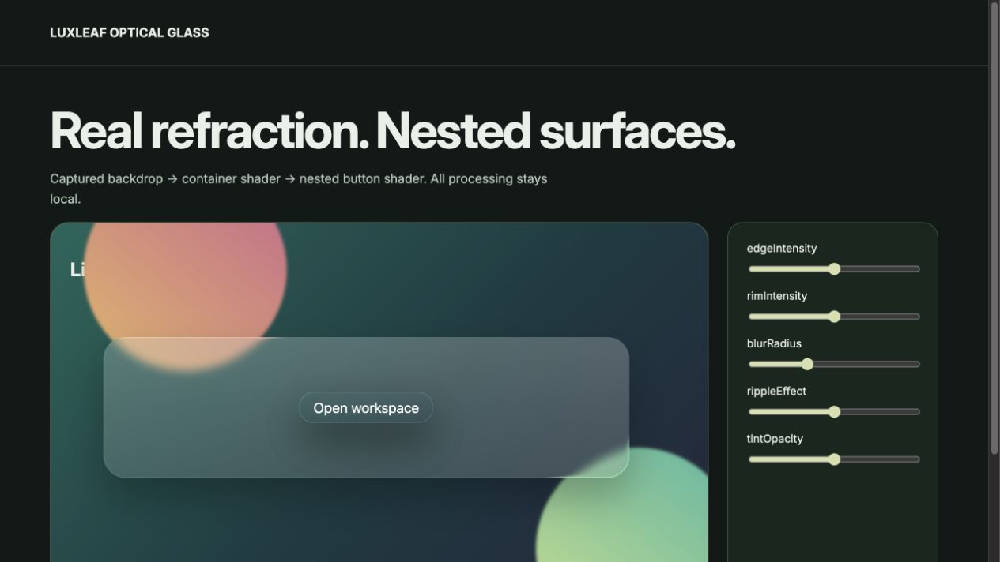
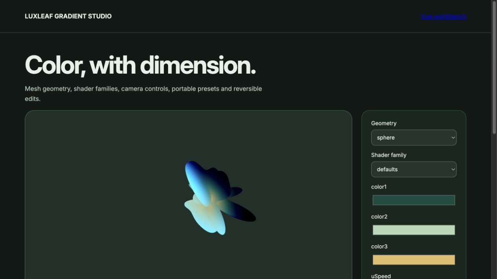
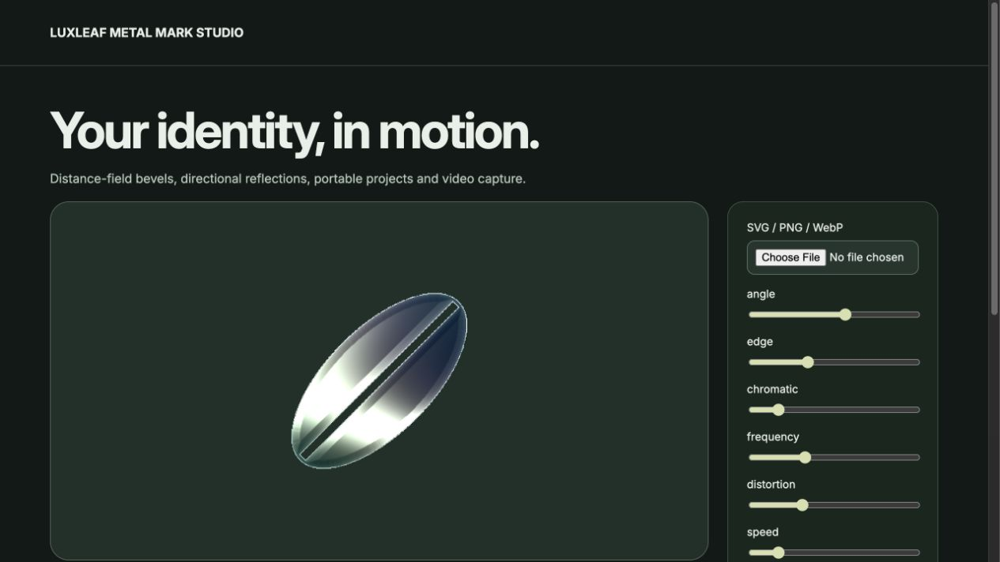
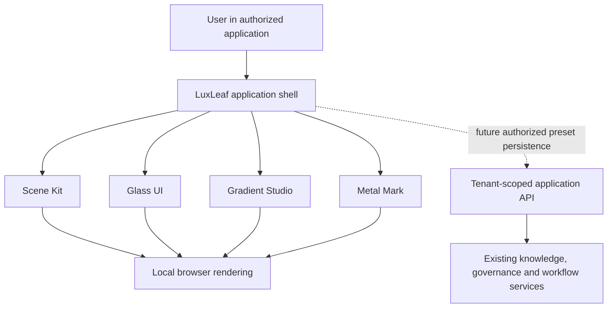

# LuxLeaf visual products

Four private v0.1.0 packages add a presentation layer to LuxLeaf's existing 31 backend and system components. Each has original product code, typed APIs, a working local workbench, architecture documentation, dependency notices, tests and a private release workflow. Original LuxLeaf work is proprietary to Michelle L. Wu; licensed foundations keep their own rights.

This page shows actual local workbench screenshots and the supported scope. It is a public demonstration record, not a hosted interactive application or source download. No customer media was used: the logo is an original generated leaf and the other scenes are synthetic.

| Product | Working v0.1 scope | Current boundary |
|---|---|---|
| **Scene Kit** | React scene composition, lit primitives, material controls, orbit interaction, strict presets | Uses React Three Fiber and Three.js as licensed foundations; does not replace their renderer ecosystem |
| **Glass UI** | Native buttons and panels, tint, blur, shape controls, optional local SVG refraction, React and imperative APIs | Browser-dependent refraction; no captured-page WebGL renderer |
| **Gradient Studio** | Original WebGL2 color fields, plane/orb/ribbon modes, motion controls, presets and PNG export | Procedural shader modes; no Figma/Framer/Vue integrations or mesh-based gradient system |
| **Metal Mark** | Original reflection shader, local PNG/WebP alpha masks, live controls and transparent PNG export | No SVG ingestion, video export or remote processing |

## Scene Kit

The local workbench changes geometry, color, roughness, metalness and movement. Demand rendering is used when motion is paused. The package exposes the licensed foundation APIs for advanced scene composition. Its basic static GLTF helper is implemented, but compressed assets, animated skinned models and remote asset workflows are outside the validated release scope.

## Glass UI

The library retains real native controls and does not capture the page. Local SVG filters enhance supported browser compositors; other browsers keep tint and blur where available. Host applications still own focus presentation, readable contrast and complete accessibility testing.

## Gradient Studio

Three-color presets are validated before becoming shader uniforms. The local renderer offers static PNG export and pauses automatic frames for reduced-motion preference, hidden documents and offscreen canvases. The shader is original LuxLeaf code; this is not a pixel-compatible recreation of another gradient product.

## Metal Mark

Logo files remain in the browser. The alpha channel supplies the mask; the renderer fits it to the canvas and generates moving reflections. Input is limited to PNG/WebP up to 8 MiB and decoded dimensions up to 4096 pixels. Presets contain settings, not image data. The implementation and leaf artwork are original; restricted third-party shader code and assets are not included.

## Architecture and system boundary

These libraries are presentation packages. They do not authorize users, call model providers, issue credentials or meter usage. A host application can persist validated presets through its tenant-scoped API; that connection is an integration contract, not a completed backend integration in these four packages. Provider credentials and permission checks belong on the server.

The renderers accept bounded settings, render locally and release their resources when disposed. Gradient Studio and Metal Mark cap device pixel ratio at two and drawing-buffer dimensions at 4096. Those bounds limit allocations; they are not evidence of measured enterprise throughput or mobile performance.

## Recorded verification

Observed locally on 2026-11-01:

| Product | Unit tests | Actual browser assertions |
|---|---:|---:|
| Scene Kit | 6 | 6 |
| Glass UI | 8 | 6 |
| Gradient Studio | 6 | 7 |
| Metal Mark | 7 | 8 |
| **Total** | **27** | **27** |

All four passed strict TypeScript checks, production builds, package-content review, and import/preset checks after installation into a fresh consumer. The browser assertions exercised real rendering or DOM behavior, live updates and cleanup; the gradient and logo checks also inspected output and PNG export. The four packages resolve to one compatible React installation in that consumer.

Private CI repeats type checks, unit tests, builds and package inspection. Browser checks are manually run through committed verification pages; they are not automated CI coverage. Cross-browser/device validation, adversarial media testing, measured resource budgets and independent accessibility/security review remain ahead. No full upstream feature parity or production certification is claimed.

## Relationship to the wider platform

The existing [system architecture](SYSTEM_ARCHITECTURE.md) and [pipeline families](SYSTEM_PIPELINES.md) describe the backend and operational portfolio. These four packages complement that work as a separate visual layer. The original 31-component catalog remains a backend/system catalog; adding four visual products does not rewrite its verification counts.

[Return to LuxLeaf](../README.md)
