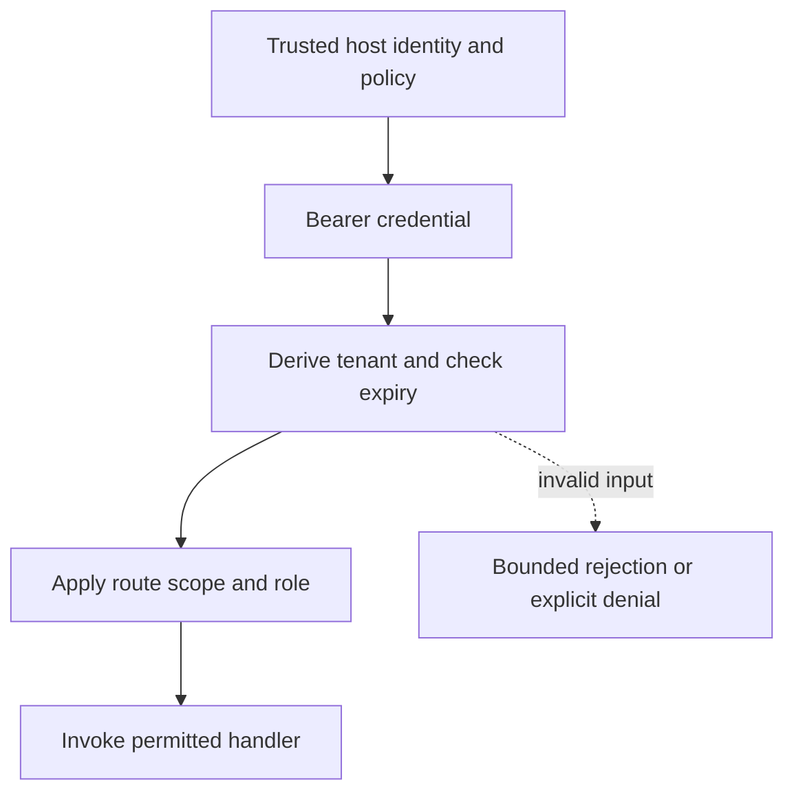

# Credential expiry and route scopes

[All component architectures](../PORTFOLIO_ARCHITECTURE.md) · [Project page](../projects/luxleaf-api.md) · [All expansion evidence](../demonstrations/all-component-expansion.md)

**luxleaf-api 0.2.0 · Business knowledge · October 31, 2026**

## Implemented contract

Boundary accepts a host clock. Credential context may include integer expires_at and allowed_routes containing method/path pairs. Expired credentials return 401; requests outside the credential route scope return 403 before handler execution, even if the role otherwise permits access.

## Component architecture



This describes local responsibilities, not independently deployed cloud services. The host supplies verified identity and policy. An external model cannot grant itself actor, tenant or operator authority through these fields. Each component call owns its transaction; cross-component flows require explicit recovery.

## Recorded synthetic evidence

The new checked scenario ran against the private implementation at commit `138e9c4f3c9c0448827176f427ae4c16d42c641f`. Its source checkout was clean. Results below are selected actual observations; private credentials, local paths and implementation source are excluded.

| Executable check | Outcome |
|---|---|
| Scoped valid credential can use permitted route | Passed |
| Route scope narrows otherwise permitted role | Passed |
| Credential expires exactly at boundary | Passed |
| Denied and expired requests do not invoke handler | Passed |

```json
{
  "permitted_status": 200,
  "scope_denied_status": 403,
  "expired_status": 401
}
```

The component test suite passed 6 tests locally. The full portfolio passed 174 component tests, 14 integration tests and 31 CLI examples. The all-component expansion record contains 122 assertions across 31 scenarios. Public CI verifies documentation and evidence structure; it does not execute private source.

## Operating boundary and future work

The credential registry and clock are host-controlled. There is no network listener, OIDC flow or persistent revocation service. Existing credentials without these fields retain legacy behavior.

These checks use synthetic fixtures and local execution. They do not establish live-cloud acceptance, production scale, compliance certification or independent security assurance. Read the [portfolio architecture](../PORTFOLIO_ARCHITECTURE.md) for trust, state and deployment boundaries.

Original implementation remains proprietary to Michelle L. Wu in private repositories. Public materials follow the [showcase license](../../LICENSE).
