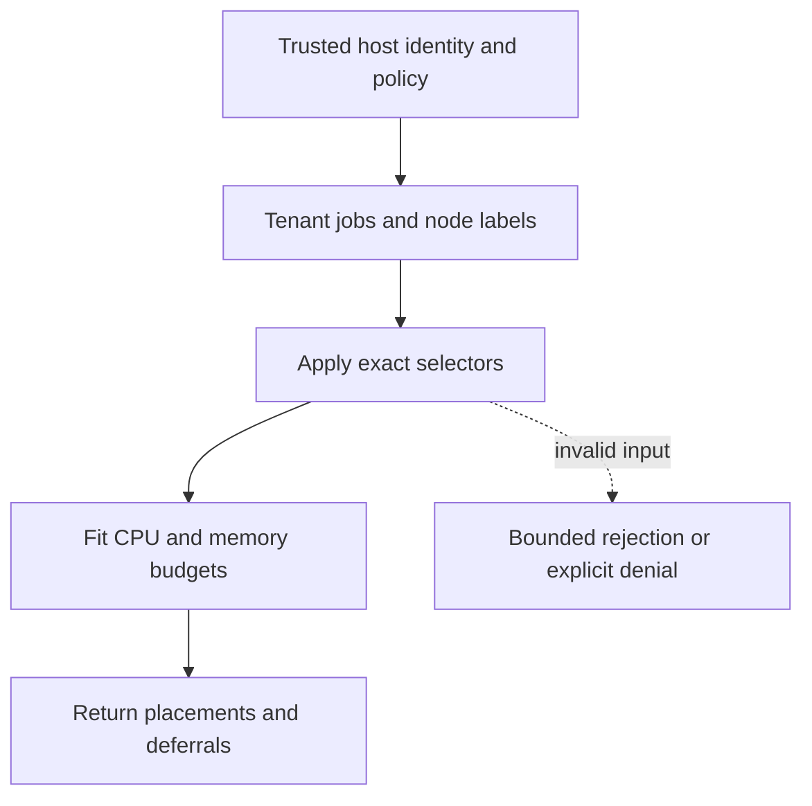

# Exact placement selectors

[All component architectures](../PORTFOLIO_ARCHITECTURE.md) · [Project page](../projects/luxleaf-batch.md) · [All expansion evidence](../demonstrations/all-component-expansion.md)

**luxleaf-batch 0.2.0 · Infrastructure and delivery · October 31, 2026**

## Implemented contract

Nodes accept labels and jobs accept selector maps of bounded identifiers. A job fits only when all selector entries match the node in addition to CPU and memory requirements. Unmatched jobs remain deferred rather than silently losing their constraints.

## Component architecture



This describes local responsibilities, not independently deployed cloud services. The host supplies verified identity and policy. An external model cannot grant itself actor, tenant or operator authority through these fields. Each component call owns its transaction; cross-component flows require explicit recovery.

## Recorded synthetic evidence

The new checked scenario ran against the private implementation at commit `a8011c9625bdd1b2fb143f1b839dd84bc09b7992`. Its source checkout was clean. Results below are selected actual observations; private credentials, local paths and implementation source are excluded.

| Executable check | Outcome |
|---|---|
| Exact placement selector chooses matching node | Passed |
| Unmatched selector defers rather than ignoring restriction | Passed |
| Invalid or unauthorized expansion request rejected | Passed |

```json
{
  "matched_node": "west",
  "unmatched_deferred": [
    "job"
  ],
  "executed": false
}
```

The component test suite passed 5 tests locally. The full portfolio passed 174 component tests, 14 integration tests and 31 CLI examples. The all-component expansion record contains 122 assertions across 31 scenarios. Public CI verifies documentation and evidence structure; it does not execute private source.

## Operating boundary and future work

These labels are trusted scheduler inputs, not verified cluster labels. The result is a placement plan only; no compute is started and multi-tenant cluster fairness is not implemented.

These checks use synthetic fixtures and local execution. They do not establish live-cloud acceptance, production scale, compliance certification or independent security assurance. Read the [portfolio architecture](../PORTFOLIO_ARCHITECTURE.md) for trust, state and deployment boundaries.

Original implementation remains proprietary to Michelle L. Wu in private repositories. Public materials follow the [showcase license](../../LICENSE).
