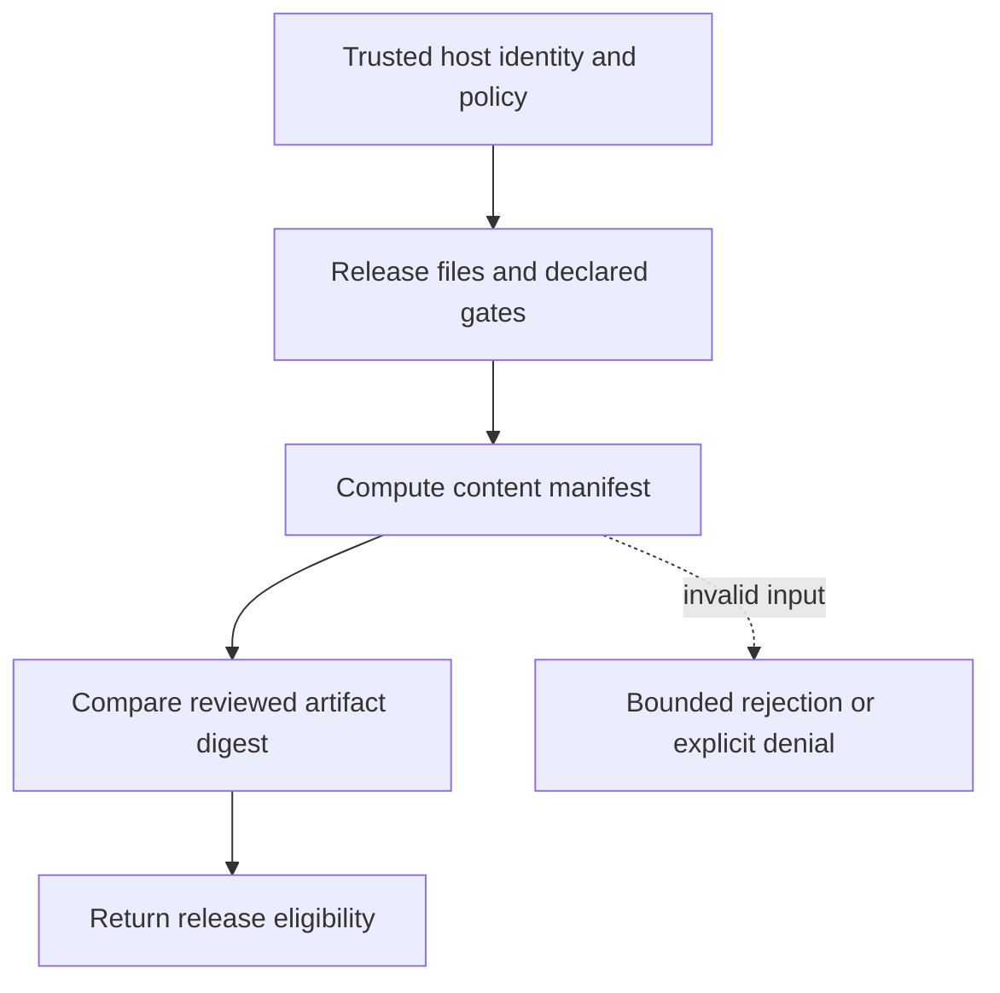

# Artifact-bound release decisions

[All component architectures](../PORTFOLIO_ARCHITECTURE.md) · [Project page](../projects/luxleaf-delivery.md) · [All expansion evidence](../demonstrations/all-component-expansion.md)

**luxleaf-delivery 0.2.0 · Infrastructure and delivery · October 31, 2026**

## Implemented contract

Optional expected_manifest_sha256 binds review to the exact content-addressed manifest. A mismatch adds artifact_identity to failed_gates and blocks release_allowed, even when supplied validation gates are true. Invalid digest syntax fails validation.

## Component architecture



This describes local responsibilities, not independently deployed cloud services. The host supplies verified identity and policy. An external model cannot grant itself actor, tenant or operator authority through these fields. Each component call owns its transaction; cross-component flows require explicit recovery.

## Recorded synthetic evidence

The new checked scenario ran against the private implementation at commit `7018fe15dc0e21ee0f210f48b9169916636f1bb9`. Its source checkout was clean. Results below are selected actual observations; private credentials, local paths and implementation source are excluded.

| Executable check | Outcome |
|---|---|
| Matching reviewed digest permits a release proposal | Passed |
| Changed content invalidates prior release approval | Passed |
| Mismatched artifact is never publishable | Passed |
| Invalid or unauthorized expansion request rejected | Passed |

```json
{
  "changed_content_allowed": false,
  "failed_gates": [
    "artifact_identity"
  ],
  "published": false
}
```

The component test suite passed 5 tests locally. The full portfolio passed 174 component tests, 14 integration tests and 31 CLI examples. The all-component expansion record contains 122 assertions across 31 scenarios. Public CI verifies documentation and evidence structure; it does not execute private source.

## Operating boundary and future work

The expected digest and gate assertions must come from trusted release review. Hashes are not signatures, and this component neither runs the declared tests nor publishes artifacts.

These checks use synthetic fixtures and local execution. They do not establish live-cloud acceptance, production scale, compliance certification or independent security assurance. Read the [portfolio architecture](../PORTFOLIO_ARCHITECTURE.md) for trust, state and deployment boundaries.

Original implementation remains proprietary to Michelle L. Wu in private repositories. Public materials follow the [showcase license](../../LICENSE).
