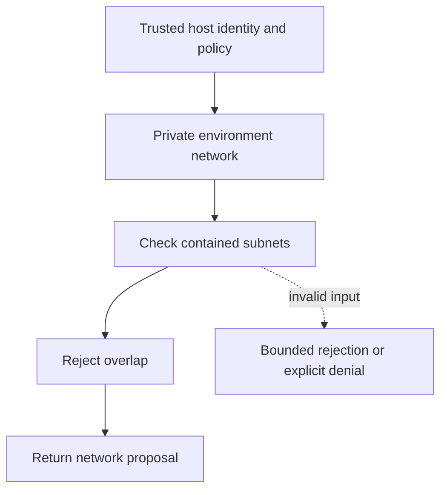

# Contained nonoverlapping subnet plans

[All component architectures](../PORTFOLIO_ARCHITECTURE.md) · [Project page](../projects/luxleaf-environments.md) · [All expansion evidence](../demonstrations/all-component-expansion.md)

**luxleaf-environments 0.2.0 · Infrastructure and delivery · October 31, 2026**

## Implemented contract

An optional subnets list accepts at most 32 canonical private IPv4 networks. Every subnet must be contained in the environment network and no two may overlap. Accepted subnets are included in the validated proposal.

## Component architecture



This describes local responsibilities, not independently deployed cloud services. The host supplies verified identity and policy. An external model cannot grant itself actor, tenant or operator authority through these fields. Each component call owns its transaction; cross-component flows require explicit recovery.

## Recorded synthetic evidence

The new checked scenario ran against the private implementation at commit `541fdd9f504582c60b7bd0d422f9083431506ff8`. Its source checkout was clean. Results below are selected actual observations; private credentials, local paths and implementation source are excluded.

| Executable check | Outcome |
|---|---|
| Disjoint contained subnets are preserved | Passed |
| Invalid or unauthorized expansion request rejected | Passed |
| Invalid or unauthorized expansion request rejected | Passed |
| Planning does not provision networks | Passed |

```json
{
  "subnets": [
    "10.0.1.0/24",
    "10.0.2.0/24"
  ],
  "provisioned": false
}
```

The component test suite passed 6 tests locally. The full portfolio passed 174 component tests, 14 integration tests and 31 CLI examples. The all-component expansion record contains 122 assertions across 31 scenarios. Public CI verifies documentation and evidence structure; it does not execute private source.

## Operating boundary and future work

These are arithmetic and configuration checks. No cloud network, route or identity is provisioned. Provider-specific reserved address rules and capacity requirements need target acceptance.

These checks use synthetic fixtures and local execution. They do not establish live-cloud acceptance, production scale, compliance certification or independent security assurance. Read the [portfolio architecture](../PORTFOLIO_ARCHITECTURE.md) for trust, state and deployment boundaries.

Original implementation remains proprietary to Michelle L. Wu in private repositories. Public materials follow the [showcase license](../../LICENSE).
