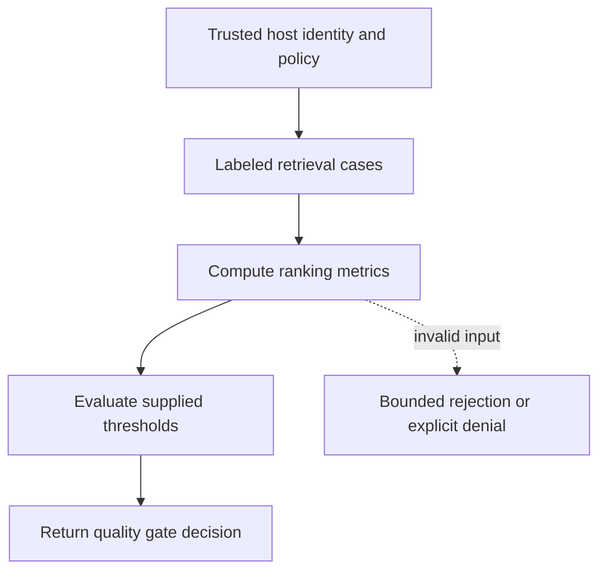

# Measured retrieval quality gates

[All component architectures](../PORTFOLIO_ARCHITECTURE.md) · [Project page](../projects/luxleaf-evaluations.md) · [All expansion evidence](../demonstrations/all-component-expansion.md)

**luxleaf-evaluations 0.2.0 · Governance and workflow · October 31, 2026**

## Implemented contract

Optional gates.minimum_mrr_basis_points and gates.minimum_recall_basis_points accept integers from 0 to 10000. The measured MRR and mean positive-case recall determine quality_gate_passed and failed_gates. Missing positive labels cannot establish a recall gate, including a zero threshold.

## Component architecture



This describes local responsibilities, not independently deployed cloud services. The host supplies verified identity and policy. An external model cannot grant itself actor, tenant or operator authority through these fields. Each component call owns its transaction; cross-component flows require explicit recovery.

## Recorded synthetic evidence

The new checked scenario ran against the private implementation at commit `7726addb3b7e9c18a5b5aac806da871366259646`. Its source checkout was clean. Results below are selected actual observations; private credentials, local paths and implementation source are excluded.

| Executable check | Outcome |
|---|---|
| Weak rank fails MRR without failing complete recall | Passed |
| Measured quality rejects release gate | Passed |
| Invalid or unauthorized expansion request rejected | Passed |
| No positive labels cannot establish recall | Passed |

```json
{
  "mrr": 0.5,
  "failed_gates": [
    "minimum_mrr_basis_points"
  ]
}
```

The component test suite passed 5 tests locally. The full portfolio passed 174 component tests, 14 integration tests and 31 CLI examples. The all-component expansion record contains 122 assertions across 31 scenarios. Public CI verifies documentation and evidence structure; it does not execute private source.

## Operating boundary and future work

Quality depends on representative labels and datasets. Passing retrieval gates does not establish answer faithfulness or production quality. Thresholds are host policy, not model-controlled overrides.

These checks use synthetic fixtures and local execution. They do not establish live-cloud acceptance, production scale, compliance certification or independent security assurance. Read the [portfolio architecture](../PORTFOLIO_ARCHITECTURE.md) for trust, state and deployment boundaries.

Original implementation remains proprietary to Michelle L. Wu in private repositories. Public materials follow the [showcase license](../../LICENSE).
