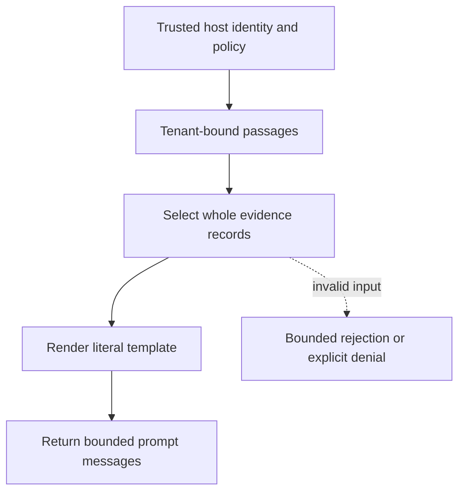

# Whole-record context budgeting

[All component architectures](../PORTFOLIO_ARCHITECTURE.md) · [Project page](../projects/luxleaf-generation.md) · [All expansion evidence](../demonstrations/all-component-expansion.md)

**luxleaf-generation 0.2.0 · Business knowledge · October 31, 2026**

## Implemented contract

Optional max_context_characters independently bounds serialized evidence JSON from 2 to 64000 characters. Records are considered in source order; a record that does not fit is omitted whole, while later smaller records may still fit. Results report included_documents, omitted_evidence and context_characters.

## Component architecture



This describes local responsibilities, not independently deployed cloud services. The host supplies verified identity and policy. An external model cannot grant itself actor, tenant or operator authority through these fields. Each component call owns its transaction; cross-component flows require explicit recovery.

## Recorded synthetic evidence

The new checked scenario ran against the private implementation at commit `1552c0c39b20c739c2c26d95d1aa0fcdd040630f`. Its source checkout was clean. Results below are selected actual observations; private credentials, local paths and implementation source are excluded.

| Executable check | Outcome |
|---|---|
| Empty evidence array fits a two-character context budget | Passed |
| Whole evidence is omitted instead of being cut mid-record | Passed |
| No document is falsely reported as included | Passed |
| Invalid or unauthorized expansion request rejected | Passed |
| Prompt preparation makes no provider call | Passed |

```json
{
  "omitted_evidence": 1,
  "context_characters": 2,
  "provider_called": false
}
```

The component test suite passed 5 tests locally. The full portfolio passed 174 component tests, 14 integration tests and 31 CLI examples. The all-component expansion record contains 122 assertions across 31 scenarios. Public CI verifies documentation and evidence structure; it does not execute private source.

## Operating boundary and future work

The complete rendered prompt still has its original maximum. Character limits are not token accounting, and missing evidence should cause downstream abstention. Prompt wording alone is not a defense against all injection attempts.

These checks use synthetic fixtures and local execution. They do not establish live-cloud acceptance, production scale, compliance certification or independent security assurance. Read the [portfolio architecture](../PORTFOLIO_ARCHITECTURE.md) for trust, state and deployment boundaries.

Original implementation remains proprietary to Michelle L. Wu in private repositories. Public materials follow the [showcase license](../../LICENSE).

## Role in the full system

This component participates in **access-knowledge** through the recorded stages `prompt`. These stages were executed in the 37-stage local acceptance composition. [Inspect the system pipeline handoffs and failure gates](../SYSTEM_PIPELINES.md), [deployment and state ownership](../SYSTEM_ARCHITECTURE.md), and [exact component commits and stage receipts](../demonstrations/system-pipeline-record.json). The linked record distinguishes local operations from unexecuted deployment proposals.
