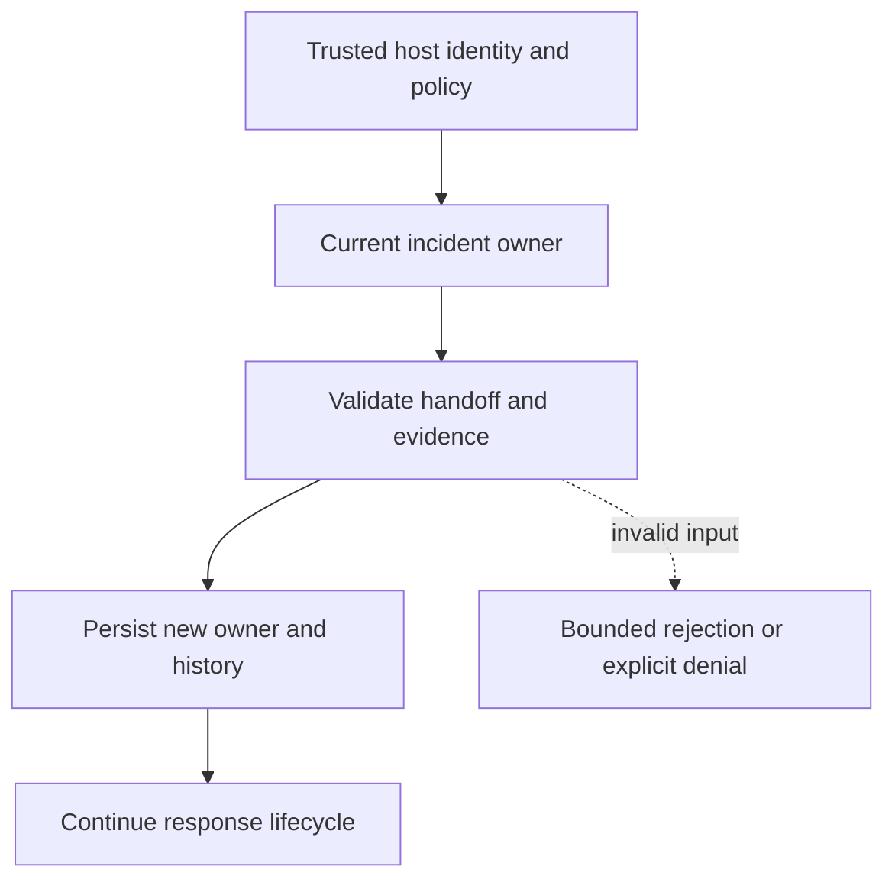

# Evidence-backed incident ownership handoff

[All component architectures](../PORTFOLIO_ARCHITECTURE.md) · [Project page](../projects/luxleaf-incidents.md) · [All expansion evidence](../demonstrations/all-component-expansion.md)

**luxleaf-incidents 0.2.0 · Operational evidence · October 31, 2026**

## Implemented contract

Assign requires the current owner as actor, a new owner and evidence. It records previous/new owners in history without changing lifecycle state. The new owner alone can perform subsequent owner-gated transitions. Closed incidents cannot be reassigned.

## Component architecture



This describes local responsibilities, not independently deployed cloud services. The host supplies verified identity and policy. An external model cannot grant itself actor, tenant or operator authority through these fields. Each component call owns its transaction; cross-component flows require explicit recovery.

## Recorded synthetic evidence

The new checked scenario ran against the private implementation at commit `3817e85fe7afa96d1cb4fce3711a04cca77d450b`. Its source checkout was clean. Results below are selected actual observations; private credentials, local paths and implementation source are excluded.

| Executable check | Outcome |
|---|---|
| Invalid or unauthorized expansion request rejected | Passed |
| New owner replaces old owner with history | Passed |
| Invalid or unauthorized expansion request rejected | Passed |
| New owner can continue response | Passed |

```json
{
  "owner": "bob",
  "status": "acknowledged",
  "handoff_recorded": true
}
```

The component test suite passed 5 tests locally. The full portfolio passed 174 component tests, 14 integration tests and 31 CLI examples. The all-component expansion record contains 122 assertions across 31 scenarios. Public CI verifies documentation and evidence structure; it does not execute private source.

## Operating boundary and future work

Actor assertions require host authentication. No notification is sent and no staffed response is implied. History is local mutable state rather than signed incident evidence.

These checks use synthetic fixtures and local execution. They do not establish live-cloud acceptance, production scale, compliance certification or independent security assurance. Read the [portfolio architecture](../PORTFOLIO_ARCHITECTURE.md) for trust, state and deployment boundaries.

Original implementation remains proprietary to Michelle L. Wu in private repositories. Public materials follow the [showcase license](../../LICENSE).
