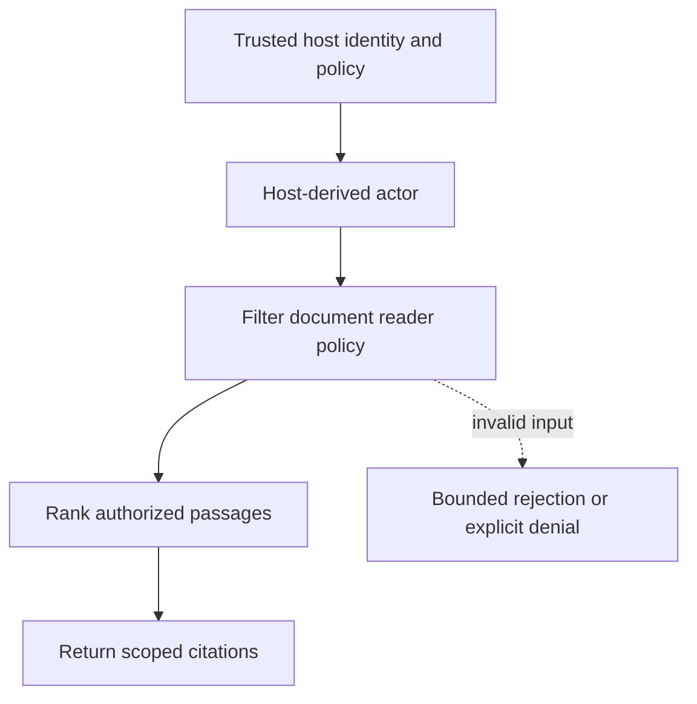

# Document reader restrictions

[All component architectures](../PORTFOLIO_ARCHITECTURE.md) · [Project page](../projects/luxleaf-knowledge.md) · [All expansion evidence](../demonstrations/all-component-expansion.md)

**luxleaf-knowledge 0.2.0 · Business knowledge · October 31, 2026**

## Implemented contract

Put accepts readers as a bounded list of actor identifiers. Omission on a new document means tenant-wide visibility; omission on update preserves its current readers. An empty list denies all query/list readers. Query and list filter restricted records using the host-derived actor before returning passages or titles.

## Component architecture



This describes local responsibilities, not independently deployed cloud services. The host supplies verified identity and policy. An external model cannot grant itself actor, tenant or operator authority through these fields. Each component call owns its transaction; cross-component flows require explicit recovery.

## Recorded synthetic evidence

The new checked scenario ran against the private implementation at commit `28794613e122646a51256465db5daea3e305c9f0`. Its source checkout was clean. Results below are selected actual observations; private credentials, local paths and implementation source are excluded.

| Executable check | Outcome |
|---|---|
| Reader policy filters passages for alice | Passed |
| Reader policy filters passages for bob | Passed |
| Restricted title is absent from unauthenticated library context | Passed |
| Other tenant cannot retrieve these documents | Passed |
| Invalid or unauthorized expansion request rejected | Passed |

```json
{
  "alice_documents": 2,
  "bob_documents": 1,
  "other_tenant_documents": 0
}
```

The component test suite passed 5 tests locally. The full portfolio passed 174 component tests, 14 integration tests and 31 CLI examples. The all-component expansion record contains 122 assertions across 31 scenarios. Public CI verifies documentation and evidence structure; it does not execute private source.

## Operating boundary and future work

The host still authorizes put/delete and derives actor identity. This is a reader allowlist, not group inheritance or an identity provider. Existing documents retain tenant-wide visibility unless restricted explicitly.

These checks use synthetic fixtures and local execution. They do not establish live-cloud acceptance, production scale, compliance certification or independent security assurance. Read the [portfolio architecture](../PORTFOLIO_ARCHITECTURE.md) for trust, state and deployment boundaries.

Original implementation remains proprietary to Michelle L. Wu in private repositories. Public materials follow the [showcase license](../../LICENSE).

## Role in the full system

This component participates in **access-knowledge** through the recorded stages `retrieve`. These stages were executed in the 37-stage local acceptance composition. [Inspect the system pipeline handoffs and failure gates](../SYSTEM_PIPELINES.md), [deployment and state ownership](../SYSTEM_ARCHITECTURE.md), and [exact component commits and stage receipts](../demonstrations/system-pipeline-record.json). The linked record distinguishes local operations from unexecuted deployment proposals.
