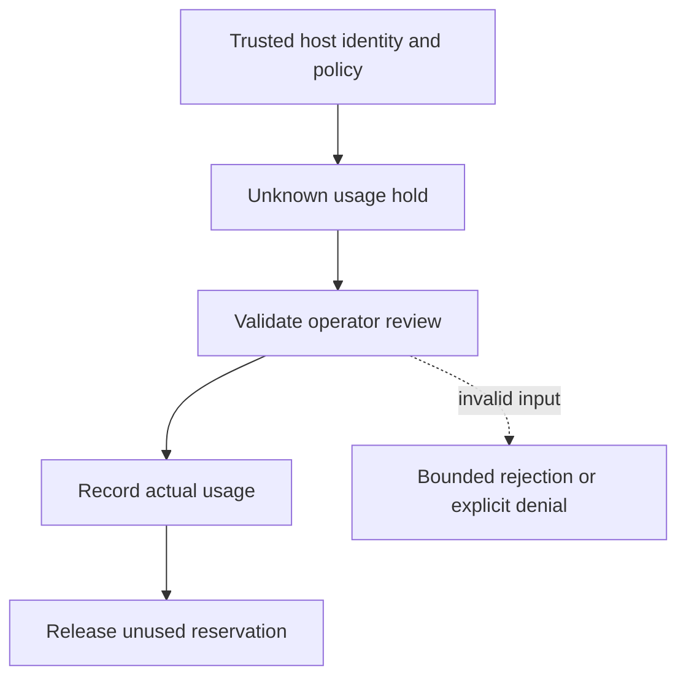

# Reviewed unknown-usage reconciliation

[All component architectures](../PORTFOLIO_ARCHITECTURE.md) · [Project page](../projects/luxleaf-metering.md) · [All expansion evidence](../demonstrations/all-component-expansion.md)

**luxleaf-metering 0.2.0 · Governance and workflow · October 31, 2026**

## Implemented contract

Reconcile accepts key, actual_micros, actor and evidence_ref only when the reservation is unknown. It records the review and settles exact usage, releasing unused held credit. Invalid reviews roll back without changing the hold.

## Component architecture



This describes local responsibilities, not independently deployed cloud services. The host supplies verified identity and policy. An external model cannot grant itself actor, tenant or operator authority through these fields. Each component call owns its transaction; cross-component flows require explicit recovery.

## Recorded synthetic evidence

The new checked scenario ran against the private implementation at commit `b945ce8ea0ee796332699bfa985e64ee1f193c3e`. Its source checkout was clean. Results below are selected actual observations; private credentials, local paths and implementation source are excluded.

| Executable check | Outcome |
|---|---|
| Invalid or unauthorized expansion request rejected | Passed |
| Invalid or unauthorized expansion request rejected | Passed |
| Invalid review preserves held credit | Passed |
| Reviewed unknown outcome settles exact usage | Passed |
| Unused hold is released | Passed |

```json
{
  "actual_micros": 20,
  "available_micros": 80,
  "reviewed": true
}
```

The component test suite passed 5 tests locally. The full portfolio passed 174 component tests, 14 integration tests and 31 CLI examples. The all-component expansion record contains 122 assertions across 31 scenarios. Public CI verifies documentation and evidence structure; it does not execute private source.

## Operating boundary and future work

Review fields are trusted host assertions; they are not provider receipts or signatures. Existing settle remains an operator interface, so the host must restrict it appropriately. Over-limit actual usage remains visible rather than being hidden.

These checks use synthetic fixtures and local execution. They do not establish live-cloud acceptance, production scale, compliance certification or independent security assurance. Read the [portfolio architecture](../PORTFOLIO_ARCHITECTURE.md) for trust, state and deployment boundaries.

Original implementation remains proprietary to Michelle L. Wu in private repositories. Public materials follow the [showcase license](../../LICENSE).
