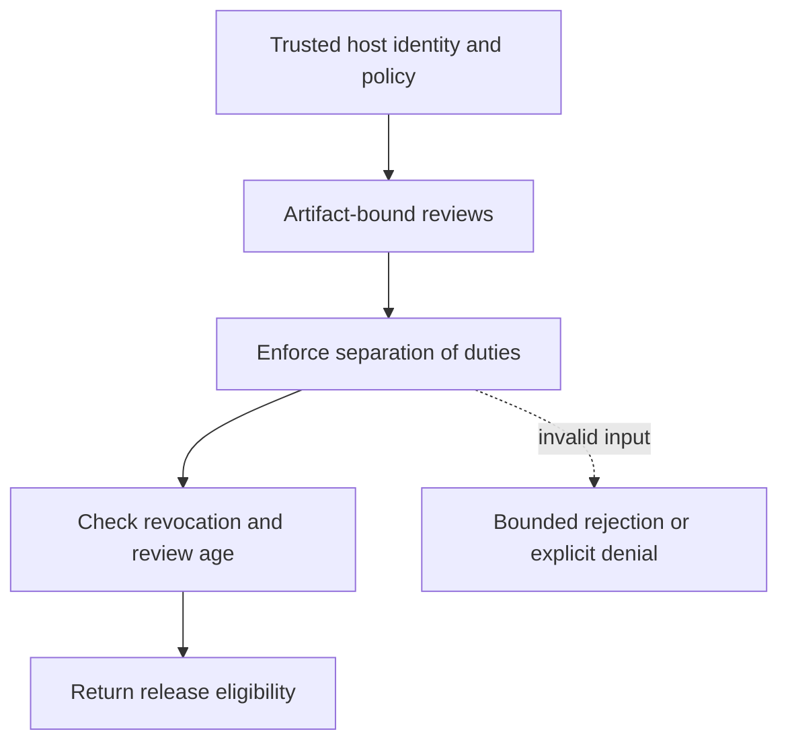

# Approval freshness and revocation

[All component architectures](../PORTFOLIO_ARCHITECTURE.md) · [Project page](../projects/luxleaf-model-governance.md) · [All expansion evidence](../demonstrations/all-component-expansion.md)

**luxleaf-model-governance 0.2.0 · Governance and workflow · October 31, 2026**

## Implemented contract

Optional revoked_people invalidates listed reviewers. Configuring maximum_approval_age_seconds requires evaluated_at and approved_at on nonrevoked approval rows. Future-dated or over-age reviews cannot satisfy their role. Separation of author, reviewer people and roles remains enforced.

## Component architecture



This describes local responsibilities, not independently deployed cloud services. The host supplies verified identity and policy. An external model cannot grant itself actor, tenant or operator authority through these fields. Each component call owns its transaction; cross-component flows require explicit recovery.

## Recorded synthetic evidence

The new checked scenario ran against the private implementation at commit `1a80645be90f27cd43af3cbcf8fbf2b3a6b32500`. Its source checkout was clean. Results below are selected actual observations; private credentials, local paths and implementation source are excluded.

| Executable check | Outcome |
|---|---|
| Expired security approval blocks release | Passed |
| Stale approval does not satisfy required role | Passed |
| Revoked reviewer cannot approve release | Passed |
| Invalid or unauthorized expansion request rejected | Passed |

```json
{
  "stale_role": "security",
  "revoked_role": "release",
  "approved": false
}
```

The component test suite passed 5 tests locally. The full portfolio passed 174 component tests, 14 integration tests and 31 CLI examples. The all-component expansion record contains 122 assertions across 31 scenarios. Public CI verifies documentation and evidence structure; it does not execute private source.

## Operating boundary and future work

The host supplies trusted time, reviewer identity and revocation state. This is not cryptographic approval verification or compliance certification. Without a freshness policy, legacy approvals retain their original behavior.

These checks use synthetic fixtures and local execution. They do not establish live-cloud acceptance, production scale, compliance certification or independent security assurance. Read the [portfolio architecture](../PORTFOLIO_ARCHITECTURE.md) for trust, state and deployment boundaries.

Original implementation remains proprietary to Michelle L. Wu in private repositories. Public materials follow the [showcase license](../../LICENSE).
