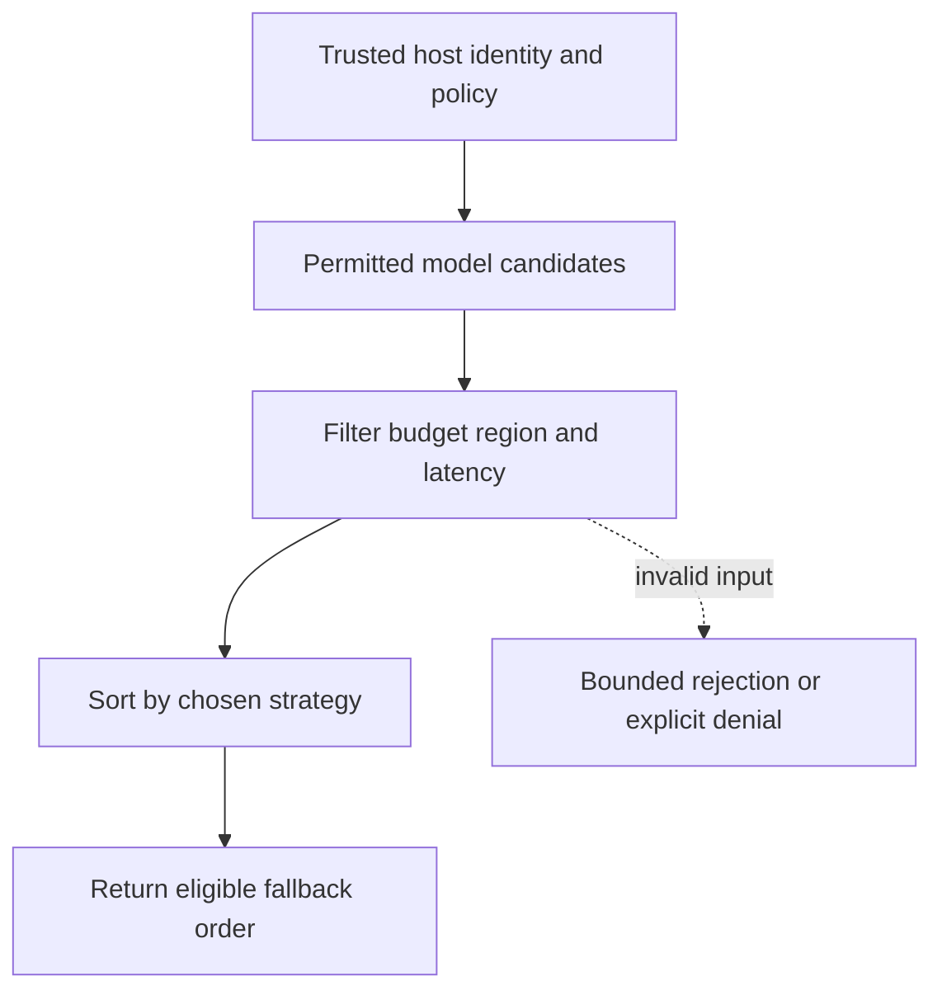

# Latency-aware routing and fallback order

[All component architectures](../PORTFOLIO_ARCHITECTURE.md) · [Project page](../projects/luxleaf-model-router.md) · [All expansion evidence](../demonstrations/all-component-expansion.md)

**luxleaf-model-router 0.2.0 · Governance and workflow · October 31, 2026**

## Implemented contract

Strategy accepts cost or latency, with cost remaining the default. Optional max_latency_ms excludes candidates beyond the supplied threshold. Eligible candidates are returned in stable preference order after permissions, region, remote policy, capacity and budget checks.

## Component architecture



This describes local responsibilities, not independently deployed cloud services. The host supplies verified identity and policy. An external model cannot grant itself actor, tenant or operator authority through these fields. Each component call owns its transaction; cross-component flows require explicit recovery.

## Recorded synthetic evidence

The new checked scenario ran against the private implementation at commit `2d79abec0f1d4d3989c8f94b3ec360e1ea038bf0`. Its source checkout was clean. Results below are selected actual observations; private credentials, local paths and implementation source are excluded.

| Executable check | Outcome |
|---|---|
| Default preference keeps cost ordering | Passed |
| Latency strategy changes selection | Passed |
| Latency limit excludes a cheaper slow model | Passed |
| Invalid or unauthorized expansion request rejected | Passed |

```json
{
  "selected": "fast",
  "rejected": [
    {
      "id": "cheap",
      "reason": "latency_limit"
    }
  ]
}
```

The component test suite passed 5 tests locally. The full portfolio passed 174 component tests, 14 integration tests and 31 CLI examples. The all-component expansion record contains 122 assertions across 31 scenarios. Public CI verifies documentation and evidence structure; it does not execute private source.

## Operating boundary and future work

Capacity, estimated cost and latency are supplied observations. No live provider health is queried and no automatic fallback invocation occurs. The host must refresh and authenticate these inputs.

These checks use synthetic fixtures and local execution. They do not establish live-cloud acceptance, production scale, compliance certification or independent security assurance. Read the [portfolio architecture](../PORTFOLIO_ARCHITECTURE.md) for trust, state and deployment boundaries.

Original implementation remains proprietary to Michelle L. Wu in private repositories. Public materials follow the [showcase license](../../LICENSE).
