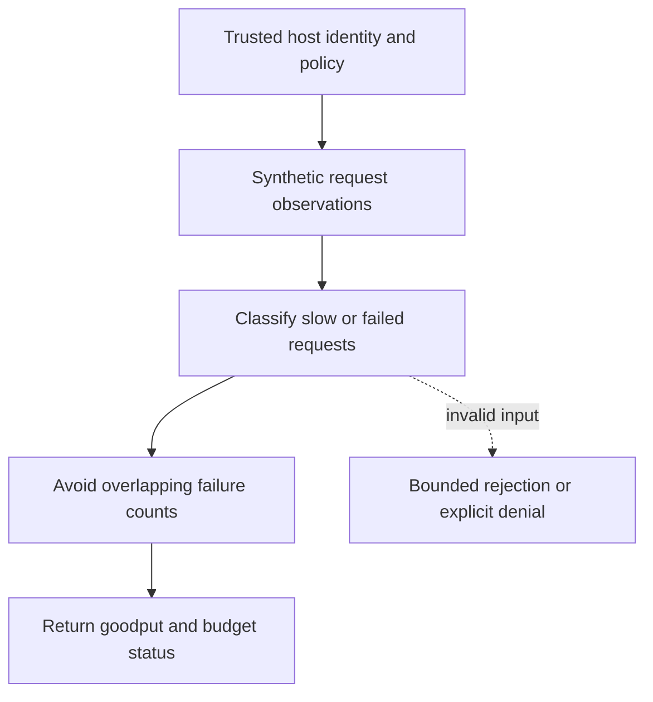

# Combined latency and availability objective

[All component architectures](../PORTFOLIO_ARCHITECTURE.md) · [Project page](../projects/luxleaf-observability.md) · [All expansion evidence](../demonstrations/all-component-expansion.md)

**luxleaf-observability 0.2.0 · Operational evidence · October 31, 2026**

## Implemented contract

Optional latency_target_ms adds slow responses to bad requests. A request that is both slow and a server error is counted once. Results report goodput, combined_budget_consumed and combined_status while retaining original availability metrics.

## Component architecture



This describes local responsibilities, not independently deployed cloud services. The host supplies verified identity and policy. An external model cannot grant itself actor, tenant or operator authority through these fields. Each component call owns its transaction; cross-component flows require explicit recovery.

## Recorded synthetic evidence

The new checked scenario ran against the private implementation at commit `f38d50debc024db96302f0ba23e4c90fa333be57`. Its source checkout was clean. Results below are selected actual observations; private credentials, local paths and implementation source are excluded.

| Executable check | Outcome |
|---|---|
| Overlapping error and latency failures count once | Passed |
| Goodput counts only fast successful requests | Passed |
| Combined objective catches slow success | Passed |
| Invalid or unauthorized expansion request rejected | Passed |

```json
{
  "bad_requests": 2,
  "goodput": 0.3333333333333333,
  "combined_status": "breached"
}
```

The component test suite passed 5 tests locally. The full portfolio passed 174 component tests, 14 integration tests and 31 CLI examples. The all-component expansion record contains 122 assertions across 31 scenarios. Public CI verifies documentation and evidence structure; it does not execute private source.

## Operating boundary and future work

Samples are supplied observations, not live ingestion. Existing server-error classification remains 5xx; workload-specific client-error treatment is separate policy. Empty samples retain no_data semantics.

These checks use synthetic fixtures and local execution. They do not establish live-cloud acceptance, production scale, compliance certification or independent security assurance. Read the [portfolio architecture](../PORTFOLIO_ARCHITECTURE.md) for trust, state and deployment boundaries.

Original implementation remains proprietary to Michelle L. Wu in private repositories. Public materials follow the [showcase license](../../LICENSE).
