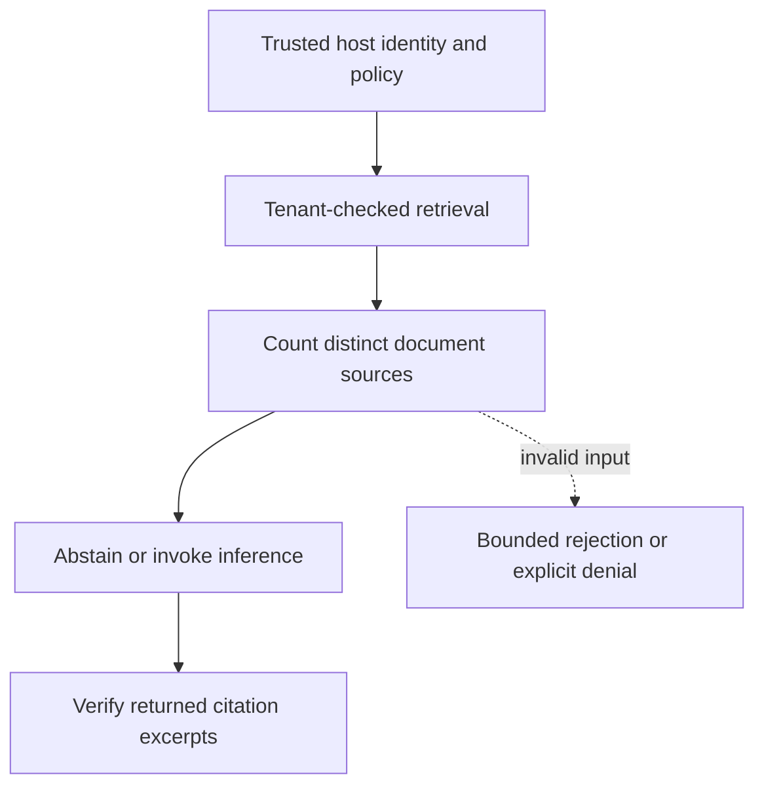

# Distinct-source quorum before inference

[All component architectures](../PORTFOLIO_ARCHITECTURE.md) · [Project page](../projects/luxleaf-rag.md) · [All expansion evidence](../demonstrations/all-component-expansion.md)

**luxleaf-rag 0.2.0 · Business knowledge · October 31, 2026**

## Implemented contract

The pipeline accepts minimum_sources from 1 to 20, and the envelope exposes the same optional field. It counts distinct document identifiers after tenant validation. Below quorum it abstains with insufficient_distinct_sources and never invokes the inference callback.

## Component architecture



This describes local responsibilities, not independently deployed cloud services. The host supplies verified identity and policy. An external model cannot grant itself actor, tenant or operator authority through these fields. Each component call owns its transaction; cross-component flows require explicit recovery.

## Recorded synthetic evidence

The new checked scenario ran against the private implementation at commit `2c6e6b25d5104d40c0df2df0e02324ddee45474d`. Its source checkout was clean. Results below are selected actual observations; private credentials, local paths and implementation source are excluded.

| Executable check | Outcome |
|---|---|
| Repeated passage cannot satisfy independent-source quorum | Passed |
| Inference is skipped below quorum | Passed |
| Two distinct sources allow local evidence answer | Passed |
| Invalid or unauthorized expansion request rejected | Passed |

```json
{
  "distinct_sources_required": 2,
  "inference_skipped_below_quorum": true
}
```

The component test suite passed 5 tests locally. The full portfolio passed 174 component tests, 14 integration tests and 31 CLI examples. The all-component expansion record contains 122 assertions across 31 scenarios. Public CI verifies documentation and evidence structure; it does not execute private source.

## Operating boundary and future work

Different identifiers do not establish independent authorship or truth. The caller controls retrieval and inference callbacks; the host must enforce reader authorization before supplying citations.

These checks use synthetic fixtures and local execution. They do not establish live-cloud acceptance, production scale, compliance certification or independent security assurance. Read the [portfolio architecture](../PORTFOLIO_ARCHITECTURE.md) for trust, state and deployment boundaries.

Original implementation remains proprietary to Michelle L. Wu in private repositories. Public materials follow the [showcase license](../../LICENSE).
