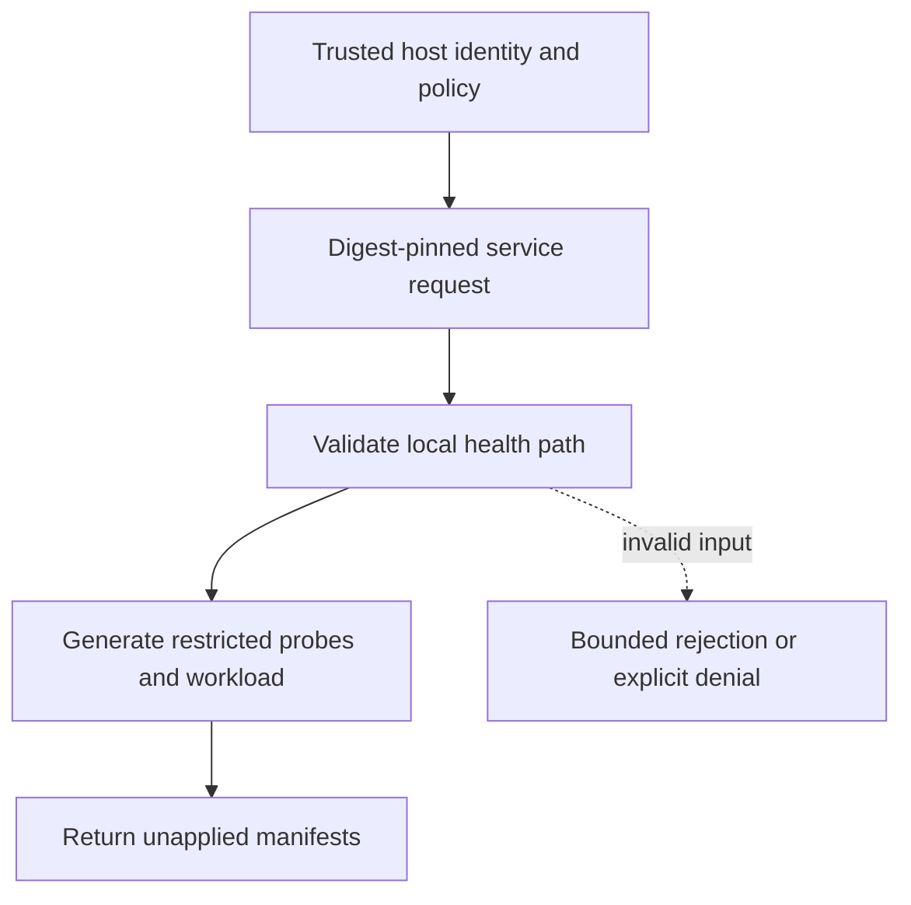

# HTTP readiness and liveness probes

[All component architectures](../PORTFOLIO_ARCHITECTURE.md) · [Project page](../projects/luxleaf-runtime.md) · [All expansion evidence](../demonstrations/all-component-expansion.md)

**luxleaf-runtime 0.2.0 · Infrastructure and delivery · October 31, 2026**

## Implemented contract

Optional health_path creates bounded HTTP readiness and liveness probes on the container port. health_period_seconds ranges from 1 to 300. Invalid absolute URLs, network-path references and traversal segments are rejected. Existing restricted container settings remain intact.

## Component architecture



This describes local responsibilities, not independently deployed cloud services. The host supplies verified identity and policy. An external model cannot grant itself actor, tenant or operator authority through these fields. Each component call owns its transaction; cross-component flows require explicit recovery.

## Recorded synthetic evidence

The new checked scenario ran against the private implementation at commit `224496cadd289675a3a177d1f0f3e573ff12b63c`. Its source checkout was clean. Results below are selected actual observations; private credentials, local paths and implementation source are excluded.

| Executable check | Outcome |
|---|---|
| Readiness uses bounded HTTP probe | Passed |
| Health definitions preserve restricted runtime | Passed |
| Invalid or unauthorized expansion request rejected | Passed |
| Invalid or unauthorized expansion request rejected | Passed |
| Invalid or unauthorized expansion request rejected | Passed |

```json
{
  "readiness_path": "/ready",
  "probe_period_seconds": 15,
  "applied": false
}
```

The component test suite passed 5 tests locally. The full portfolio passed 174 component tests, 14 integration tests and 31 CLI examples. The all-component expansion record contains 122 assertions across 31 scenarios. Public CI verifies documentation and evidence structure; it does not execute private source.

## Operating boundary and future work

The application must serve an appropriate endpoint; no health request or cluster apply occurs here. A single path drives both probes, so the host must choose a suitable health contract or extend separate endpoints before target deployment.

These checks use synthetic fixtures and local execution. They do not establish live-cloud acceptance, production scale, compliance certification or independent security assurance. Read the [portfolio architecture](../PORTFOLIO_ARCHITECTURE.md) for trust, state and deployment boundaries.

Original implementation remains proprietary to Michelle L. Wu in private repositories. Public materials follow the [showcase license](../../LICENSE).

## Role in the full system

This component participates in **deployment-recovery** through the recorded stages `runtime`. These stages were executed in the 37-stage local acceptance composition. [Inspect the system pipeline handoffs and failure gates](../SYSTEM_PIPELINES.md), [deployment and state ownership](../SYSTEM_ARCHITECTURE.md), and [exact component commits and stage receipts](../demonstrations/system-pipeline-record.json). The linked record distinguishes local operations from unexecuted deployment proposals.
