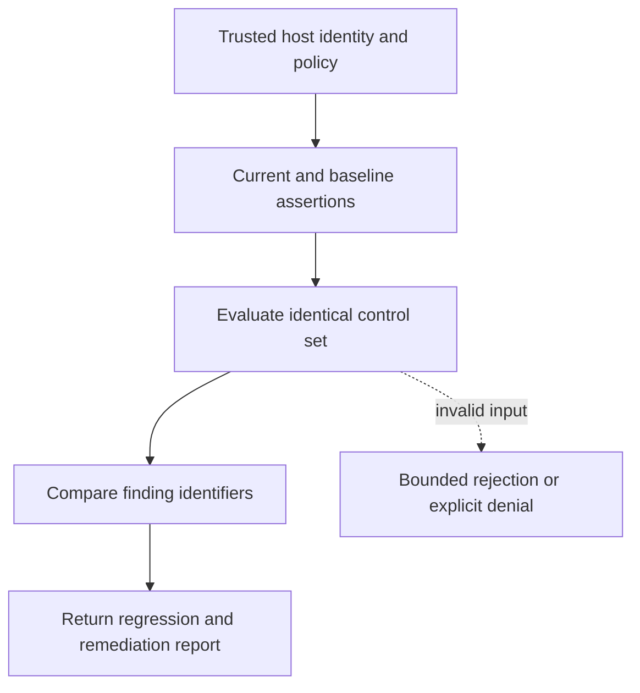

# Posture regression comparison

[All component architectures](../PORTFOLIO_ARCHITECTURE.md) · [Project page](../projects/luxleaf-security.md) · [All expansion evidence](../demonstrations/all-component-expansion.md)

**luxleaf-security 0.2.0 · Operational evidence · October 31, 2026**

## Implemented contract

Optional baseline_configuration is evaluated using the same controls as the current configuration. Comparison reports introduced, resolved and unchanged finding identifiers. A resolved finding never cancels an unrelated new failure.

## Component architecture



This describes local responsibilities, not independently deployed cloud services. The host supplies verified identity and policy. An external model cannot grant itself actor, tenant or operator authority through these fields. Each component call owns its transaction; cross-component flows require explicit recovery.

## Recorded synthetic evidence

The new checked scenario ran against the private implementation at commit `f192120296f070855f86baefcd9ec6f7f8236f39`. Its source checkout was clean. Results below are selected actual observations; private credentials, local paths and implementation source are excluded.

| Executable check | Outcome |
|---|---|
| Posture comparison identifies new and resolved findings | Passed |
| A resolved issue does not cancel a new failure | Passed |
| Invalid or unauthorized expansion request rejected | Passed |

```json
{
  "comparison": {
    "introduced": [
      "tls"
    ],
    "resolved": [
      "backups"
    ],
    "unchanged": []
  },
  "certified": false
}
```

The component test suite passed 5 tests locally. The full portfolio passed 174 component tests, 14 integration tests and 31 CLI examples. The all-component expansion record contains 122 assertions across 31 scenarios. Public CI verifies documentation and evidence structure; it does not execute private source.

## Operating boundary and future work

Both configurations are supplied assertions. The evaluator does not inspect a deployed environment, run scanners or certify controls. It reports differences without suppressing findings.

These checks use synthetic fixtures and local execution. They do not establish live-cloud acceptance, production scale, compliance certification or independent security assurance. Read the [portfolio architecture](../PORTFOLIO_ARCHITECTURE.md) for trust, state and deployment boundaries.

Original implementation remains proprietary to Michelle L. Wu in private repositories. Public materials follow the [showcase license](../../LICENSE).

## Role in the full system

This component participates in **governed-release** through the recorded stages `posture`. These stages were executed in the 37-stage local acceptance composition. [Inspect the system pipeline handoffs and failure gates](../SYSTEM_PIPELINES.md), [deployment and state ownership](../SYSTEM_ARCHITECTURE.md), and [exact component commits and stage receipts](../demonstrations/system-pipeline-record.json). The linked record distinguishes local operations from unexecuted deployment proposals.
