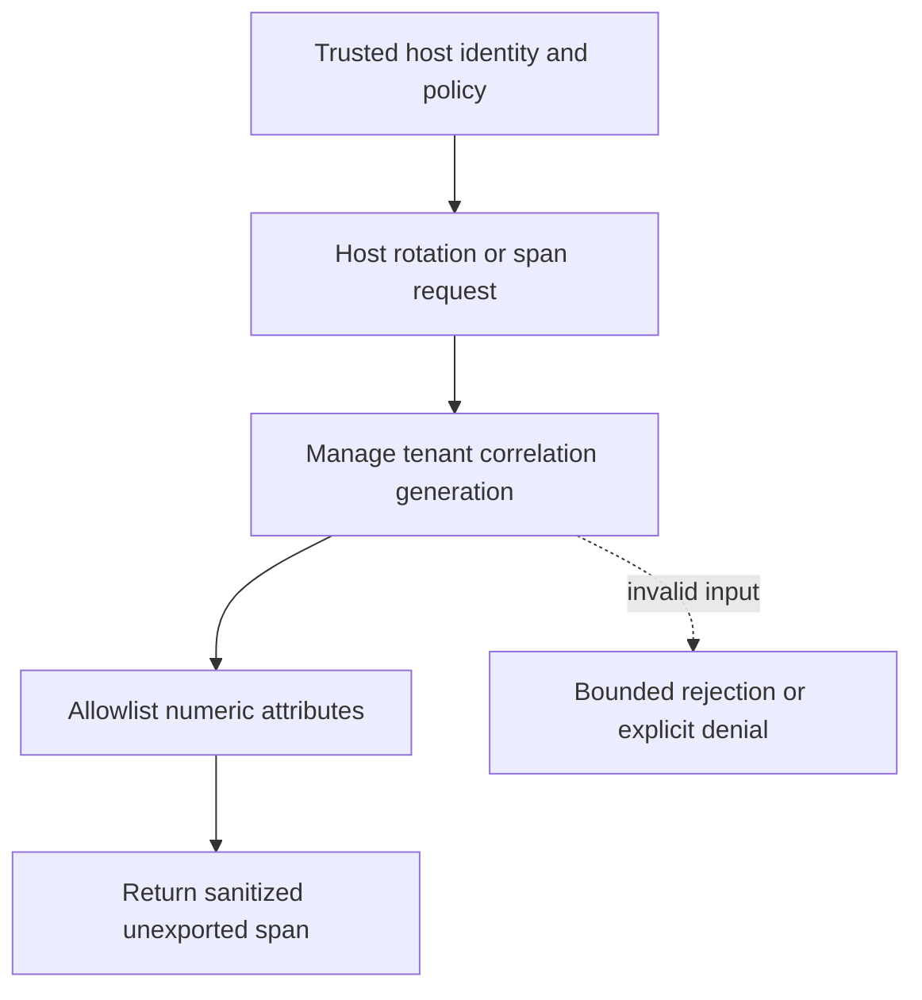

# Explicit pseudonym-key rotation

[All component architectures](../PORTFOLIO_ARCHITECTURE.md) · [Project page](../projects/luxleaf-telemetry.md) · [All expansion evidence](../demonstrations/all-component-expansion.md)

**luxleaf-telemetry 0.2.0 · Operational evidence · October 31, 2026**

## Implemented contract

Trusted op=rotate replaces the tenant component pseudonym key and increments key_generation. Later spans use the new pseudonym while retaining attribute allowlists. Rotation returns no key, and generation is visible with each result.

## Component architecture



This describes local responsibilities, not independently deployed cloud services. The host supplies verified identity and policy. An external model cannot grant itself actor, tenant or operator authority through these fields. Each component call owns its transaction; cross-component flows require explicit recovery.

## Recorded synthetic evidence

The new checked scenario ran against the private implementation at commit `17ef1092339aea4199e8ebbb9265647063fbf5dd`. Its source checkout was clean. Results below are selected actual observations; private credentials, local paths and implementation source are excluded.

| Executable check | Outcome |
|---|---|
| Pseudonym is stable before rotation | Passed |
| Rotation changes correlation identifier | Passed |
| New generation is visible without key disclosure | Passed |
| Content remains excluded after rotation | Passed |

```json
{
  "generation": 2,
  "pseudonym_changed": true,
  "dropped_attributes": 1
}
```

The component test suite passed 5 tests locally. The full portfolio passed 174 component tests, 14 integration tests and 31 CLI examples. The all-component expansion record contains 122 assertions across 31 scenarios. Public CI verifies documentation and evidence structure; it does not execute private source.

## Operating boundary and future work

Rotation is local and does not delete already exported or retained spans. The outer library envelope still contains tenant context; exporters must select the sanitized span rather than serializing the whole response. Host authorization and key protection remain required.

These checks use synthetic fixtures and local execution. They do not establish live-cloud acceptance, production scale, compliance certification or independent security assurance. Read the [portfolio architecture](../PORTFOLIO_ARCHITECTURE.md) for trust, state and deployment boundaries.

Original implementation remains proprietary to Michelle L. Wu in private repositories. Public materials follow the [showcase license](../../LICENSE).

## Role in the full system

This component participates in **operations-response** through the recorded stages `span`. These stages were executed in the 37-stage local acceptance composition. [Inspect the system pipeline handoffs and failure gates](../SYSTEM_PIPELINES.md), [deployment and state ownership](../SYSTEM_ARCHITECTURE.md), and [exact component commits and stage receipts](../demonstrations/system-pipeline-record.json). The linked record distinguishes local operations from unexecuted deployment proposals.
