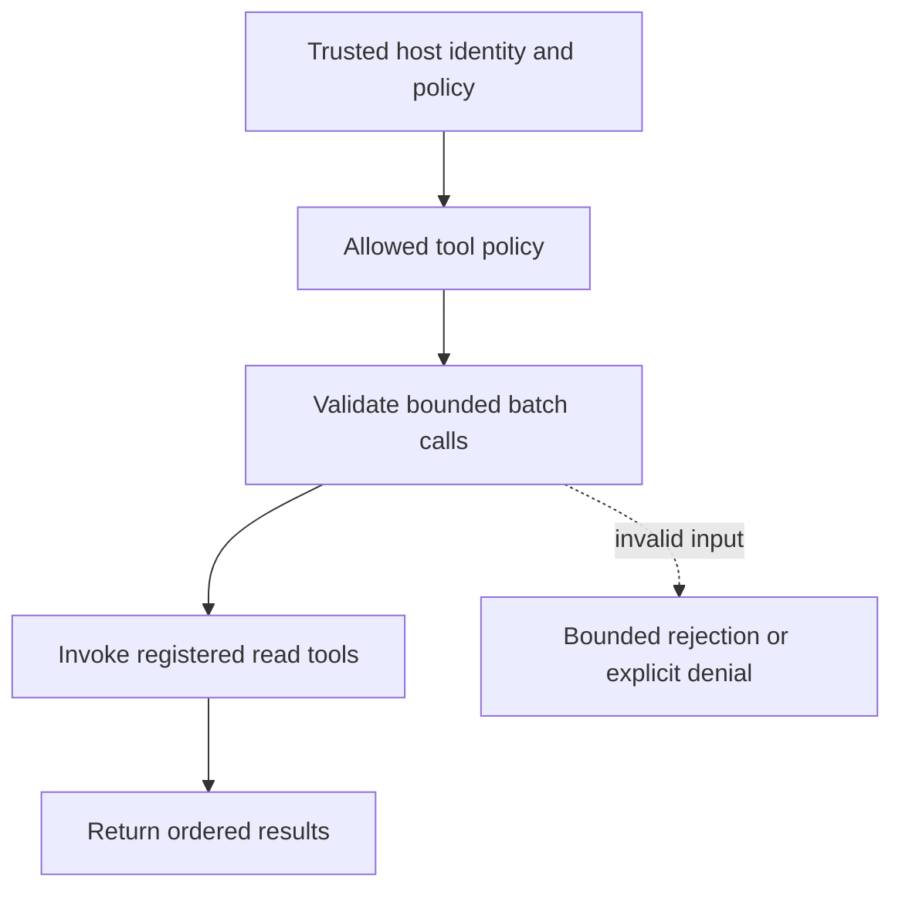

# Bounded local tool batches

[All component architectures](../PORTFOLIO_ARCHITECTURE.md) · [Project page](../projects/luxleaf-tool-protocol.md) · [All expansion evidence](../demonstrations/all-component-expansion.md)

**luxleaf-tool-protocol 0.2.0 · Agents and tools · October 31, 2026**

## Implemented contract

Method=batch accepts one to ten calls, each containing exactly name and arguments. Every call uses the same permitted-tools policy and the existing argument validation. Results preserve call order. Any invalid call rejects the overall request.

## Component architecture



This describes local responsibilities, not independently deployed cloud services. The host supplies verified identity and policy. An external model cannot grant itself actor, tenant or operator authority through these fields. Each component call owns its transaction; cross-component flows require explicit recovery.

## Recorded synthetic evidence

The new checked scenario ran against the private implementation at commit `791a16d70047046a31b5c8bbcd5e88a4b5339ef0`. Its source checkout was clean. Results below are selected actual observations; private credentials, local paths and implementation source are excluded.

| Executable check | Outcome |
|---|---|
| Batch preserves call order and results | Passed |
| Invalid or unauthorized expansion request rejected | Passed |
| Invalid or unauthorized expansion request rejected | Passed |

```json
{
  "results": [
    {
      "name": "text.count",
      "result": {
        "words": 2
      },
      "effect": "read"
    },
    {
      "name": "text.excerpt",
      "result": {
        "text": "abc"
      },
      "effect": "read"
    }
  ],
  "protocol": "luxleaf-tools/1"
}
```

The component test suite passed 5 tests locally. The full portfolio passed 174 component tests, 14 integration tests and 31 CLI examples. The all-component expansion record contains 122 assertions across 31 scenarios. Public CI verifies documentation and evidence structure; it does not execute private source.

## Operating boundary and future work

The registry contains only local read operations. This is LuxLeaf tools/1, not MCP or a remote transport. No partial results are returned on rejection; this is not a general atomic remote batch guarantee.

These checks use synthetic fixtures and local execution. They do not establish live-cloud acceptance, production scale, compliance certification or independent security assurance. Read the [portfolio architecture](../PORTFOLIO_ARCHITECTURE.md) for trust, state and deployment boundaries.

Original implementation remains proprietary to Michelle L. Wu in private repositories. Public materials follow the [showcase license](../../LICENSE).
