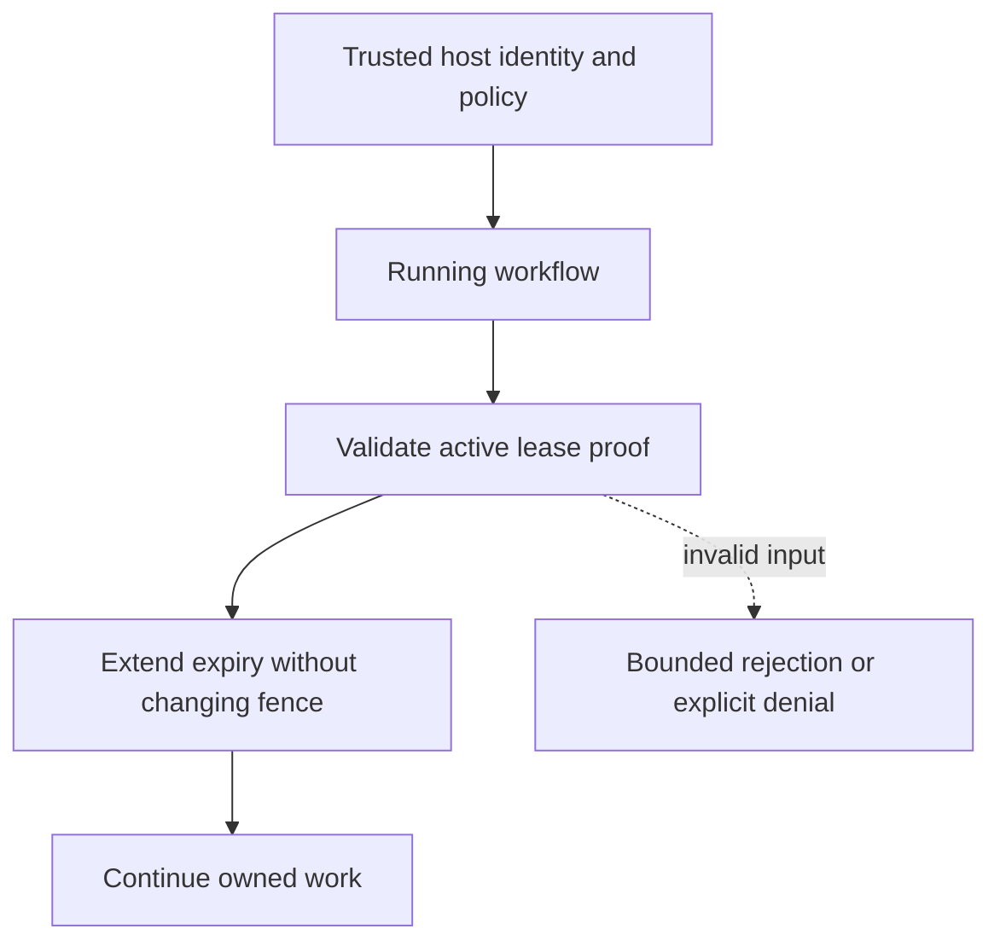

# Active workflow lease renewal

[All component architectures](../PORTFOLIO_ARCHITECTURE.md) · [Project page](../projects/luxleaf-workflows.md) · [All expansion evidence](../demonstrations/all-component-expansion.md)

**luxleaf-workflows 0.2.0 · Governance and workflow · October 31, 2026**

## Implemented contract

Renew requires job id, matching lease_token and fence, and optional lease_seconds from 1 to 3600. It extends expiry to the greater of existing expiry or current host time plus duration. The fence and worker claim remain unchanged. Expired, uncertain or completed work cannot renew.

## Component architecture



This describes local responsibilities, not independently deployed cloud services. The host supplies verified identity and policy. An external model cannot grant itself actor, tenant or operator authority through these fields. Each component call owns its transaction; cross-component flows require explicit recovery.

## Recorded synthetic evidence

The new checked scenario ran against the private implementation at commit `98114a4263cd0e9c82173156d2359b432c886d8b`. Its source checkout was clean. Results below are selected actual observations; private credentials, local paths and implementation source are excluded.

| Executable check | Outcome |
|---|---|
| Invalid or unauthorized expansion request rejected | Passed |
| Renewal extends only the current lease | Passed |
| Invalid or unauthorized expansion request rejected | Passed |
| Expired work is not silently reclaimed | Passed |

```json
{
  "renewed_expiry": 1035,
  "expired_renewal_rejected": true
}
```

The component test suite passed 6 tests locally. The full portfolio passed 174 component tests, 14 integration tests and 31 CLI examples. The all-component expansion record contains 122 assertions across 31 scenarios. Public CI verifies documentation and evidence structure; it does not execute private source.

## Operating boundary and future work

The clock is local wall time. Renewal does not prove a worker is healthy or establish remote fencing. A lease can be repeatedly renewed by its valid holder; the host should enforce workload deadlines.

These checks use synthetic fixtures and local execution. They do not establish live-cloud acceptance, production scale, compliance certification or independent security assurance. Read the [portfolio architecture](../PORTFOLIO_ARCHITECTURE.md) for trust, state and deployment boundaries.

Original implementation remains proprietary to Michelle L. Wu in private repositories. Public materials follow the [showcase license](../../LICENSE).

## Subsequent integration release

Version 0.3.0 adds [persistent coordination and real process-interruption evidence](../demonstrations/coordinated-knowledge-recovery.md). This page preserves the earlier 0.2.0 expansion record; the new page describes the implemented cross-package flow and its current limits.
