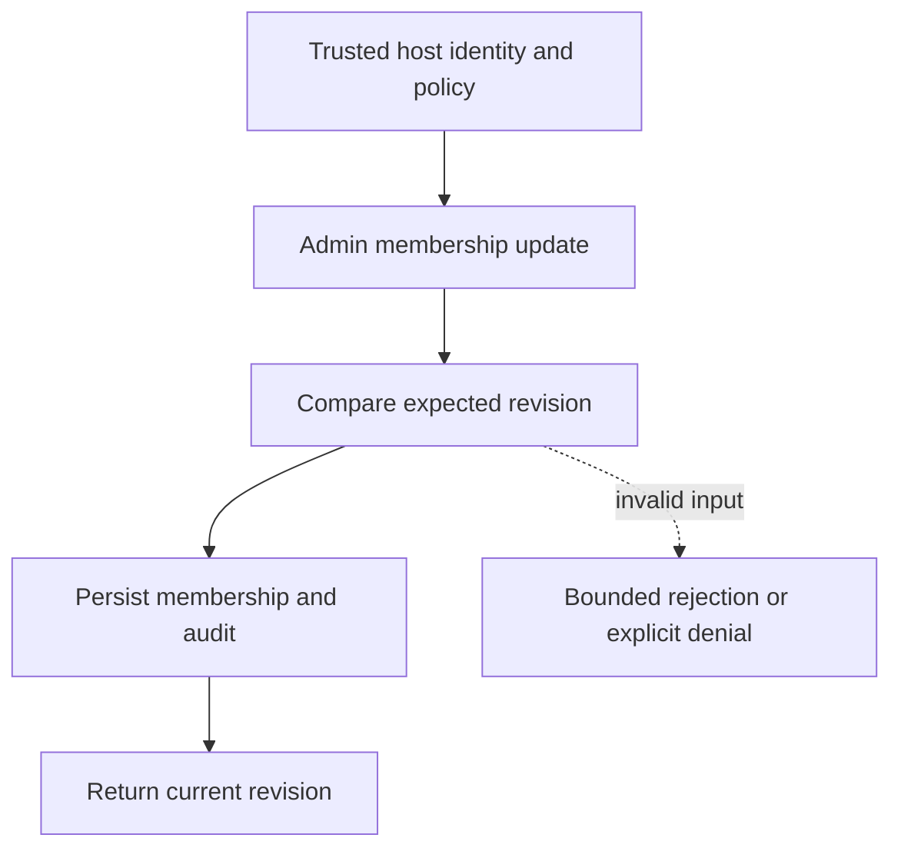

# Membership revisions and audit

[All component architectures](../PORTFOLIO_ARCHITECTURE.md) · [Project page](../projects/luxleaf-workspace.md) · [All expansion evidence](../demonstrations/all-component-expansion.md)

**luxleaf-workspace 0.2.0 · Business knowledge · October 31, 2026**

## Implemented contract

For member updates, optional expected_revision must equal the current revision. Each accepted member update advances the revision and records actor, target, previous membership and current membership. Administrators can request op=audit. Bootstrap remains revision zero.

## Component architecture



This describes local responsibilities, not independently deployed cloud services. The host supplies verified identity and policy. An external model cannot grant itself actor, tenant or operator authority through these fields. Each component call owns its transaction; cross-component flows require explicit recovery.

## Recorded synthetic evidence

The new checked scenario ran against the private implementation at commit `046d2fb8ba0415700e94bc82b439cd25335359ad`. Its source checkout was clean. Results below are selected actual observations; private credentials, local paths and implementation source are excluded.

| Executable check | Outcome |
|---|---|
| Invalid or unauthorized expansion request rejected | Passed |
| Invalid or unauthorized expansion request rejected | Passed |
| Stale update did not create a member or advance revision | Passed |
| Audit identifies who changed membership | Passed |

```json
{
  "revision": 1,
  "audited_changes": 1
}
```

The component test suite passed 5 tests locally. The full portfolio passed 174 component tests, 14 integration tests and 31 CLI examples. The all-component expansion record contains 122 assertions across 31 scenarios. Public CI verifies documentation and evidence structure; it does not execute private source.

## Operating boundary and future work

Actor identity must come from the authenticated host. Audit is local mutable state, not signed evidence. Retention is bounded by the existing state limit.

These checks use synthetic fixtures and local execution. They do not establish live-cloud acceptance, production scale, compliance certification or independent security assurance. Read the [portfolio architecture](../PORTFOLIO_ARCHITECTURE.md) for trust, state and deployment boundaries.

Original implementation remains proprietary to Michelle L. Wu in private repositories. Public materials follow the [showcase license](../../LICENSE).
