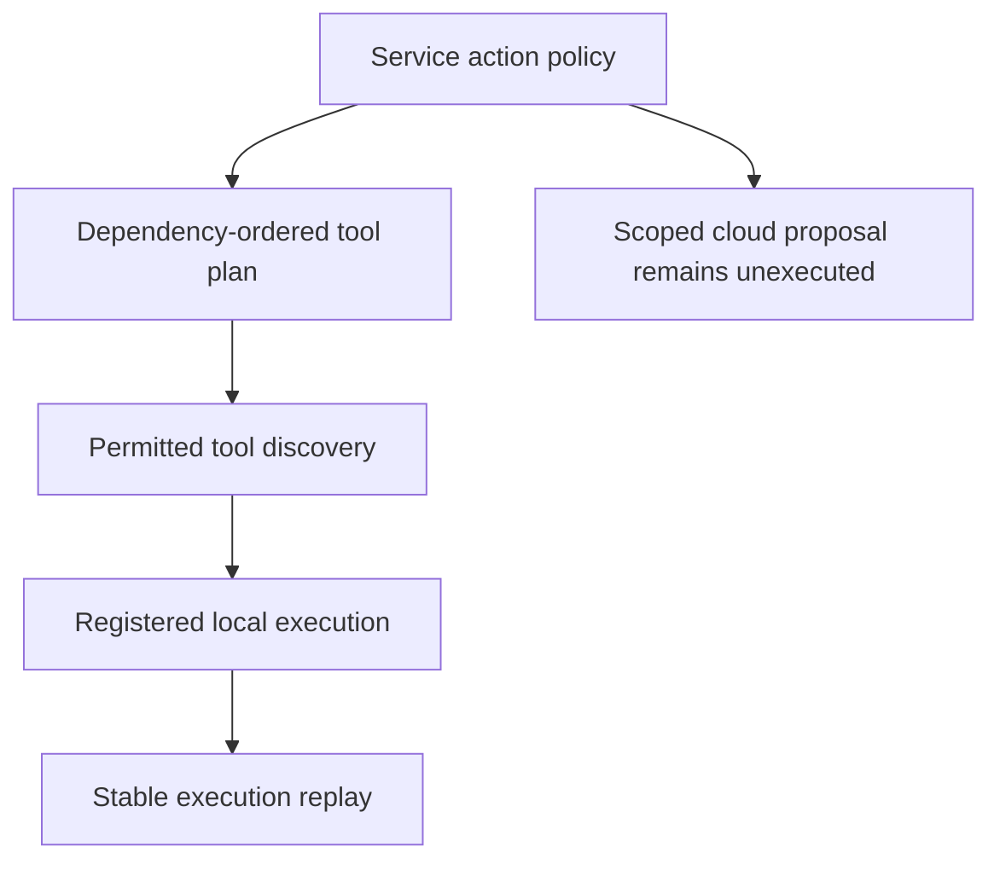

[All demonstrations](../DEMONSTRATIONS.md) · [All projects](../INTEGRATIONS.md)

# Controlled agent work

Plan two local text operations and evaluate a narrowly scoped cloud-inventory proposal.

**Recorded synthetic demonstration · October 30, 2026 · No live cloud calls**

Only registered local text functions execute. The cloud action is a policy decision, not a cloud call.

## Observed outcomes
- The count operation is ordered before its dependent excerpt operation.
- The local runtime and tool interface agree; replay returns the existing execution record.
- An out-of-scope cloud resource is rejected, and the eligible proposal is never executed.

## Flow



## Inspect the execution

The sequence below records actual local component results. Generated plans and supplied assertions are labeled at the step where they occur.

<a id="step-1"></a>

### 1. Authorize the intended service action

[luxleaf-service-policy](../projects/luxleaf-service-policy.md) · **executed local component**

<details>
<summary>Inspect recorded result</summary>

```json
{
  "allowed": true,
  "reason": "explicit_allow"
}
```

</details>

<a id="step-2"></a>

### 2. Order a bounded plan by dependencies

[luxleaf-agent-plans](../projects/luxleaf-agent-plans.md) · **executed local component**

<details>
<summary>Inspect recorded result</summary>

```json
{
  "steps": [
    {
      "id": "count",
      "tool": "text.count",
      "depends_on": [],
      "effect": "read",
      "arguments": {
        "text": "Complete privacy training before receiving workspace access."
      }
    },
    {
      "id": "excerpt",
      "tool": "text.excerpt",
      "depends_on": [
        "count"
      ],
      "effect": "read",
      "arguments": {
        "text": "Complete privacy training before receiving workspace access.",
        "limit": 16
      }
    }
  ],
  "approval_required": [],
  "executed": false
}
```

</details>

<a id="step-3"></a>

### 3. Discover the permitted local tools

[luxleaf-tool-protocol](../projects/luxleaf-tool-protocol.md) · **executed local component**

<details>
<summary>Inspect recorded result</summary>

```json
{
  "protocol": "luxleaf-tools/1",
  "tools": [
    {
      "name": "text.count",
      "description": "Count Unicode whitespace-separated words",
      "required": [
        "text"
      ],
      "effect": "read"
    },
    {
      "name": "text.excerpt",
      "description": "Return a bounded literal excerpt",
      "required": [
        "text",
        "limit"
      ],
      "effect": "read"
    }
  ]
}
```

</details>

<a id="step-4"></a>

### 4. Execute registered local functions

[luxleaf-agent-runtime](../projects/luxleaf-agent-runtime.md) · **executed local component**

<details>
<summary>Inspect recorded result</summary>

```json
{
  "plan_sha256": "bd58e6c3dfea6625eee80daf083518e81d8a5b1a13e0da1354b783e4ce3b5765",
  "status": "completed",
  "steps": [
    {
      "id": "count",
      "status": "completed",
      "result": {
        "words": 7
      }
    },
    {
      "id": "excerpt",
      "status": "completed",
      "result": {
        "text": "Complete privacy"
      }
    }
  ]
}
```

</details>

<a id="step-5"></a>

### 5. Evaluate a scoped inventory proposal

[luxleaf-cloud-tools](../projects/luxleaf-cloud-tools.md) · **executed local component**

<details>
<summary>Inspect recorded result</summary>

```json
{
  "account": "000000000000",
  "service": "storage",
  "action": "inventory.list",
  "resource": "synthetic-business/documents/",
  "authorized_plan": true,
  "executed": false
}
```

</details>

<a id="step-6"></a>

### 6. A resource outside the permitted prefix is denied

[luxleaf-cloud-tools](../projects/luxleaf-cloud-tools.md) · **executed negative case**

<details>
<summary>Inspect recorded result</summary>

```json
{
  "rejected": true
}
```

</details>

## Checks that passed

- An unlisted service action is denied.
- The dependency precedes its consumer.
- The tool result agrees across interfaces and replay returns the same execution record.
- An eligible cloud proposal remains unexecuted.
- A resource outside the permitted prefix is denied

## Evidence and scope

The [machine-readable record](record.json) contains the complete five-journey run, source commit identifiers and checks. The private developer kit contains the repeatable runner. Public CI checks this record’s structure, coverage and publication boundaries; it does not execute private code.

These results establish the demonstrated synthetic behavior. They do not measure production quality, infrastructure capacity, real approval authenticity or live provider availability. [Validation scope](../VALIDATION.md).
