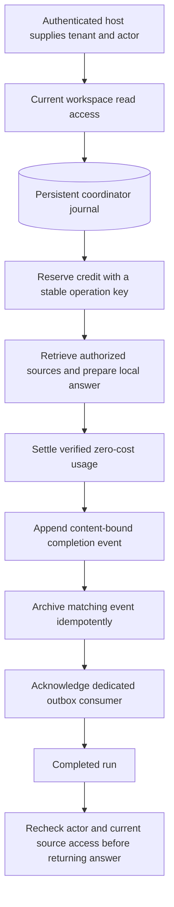
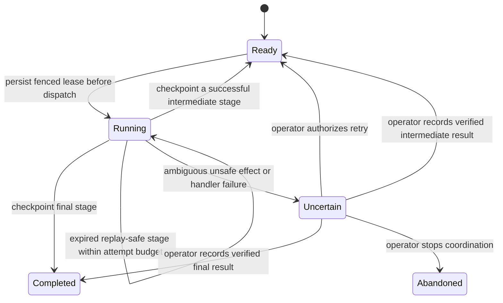

# Durable knowledge flow: recovery after real worker interruption

[Portfolio architecture](../PORTFOLIO_ARCHITECTURE.md) · [Workflow package](../projects/luxleaf-workflows.md) · [Earlier demonstrations](../DEMONSTRATIONS.md)

**Workflows 0.3.0 · Developer Kit 0.3.0 · Six real process-exit boundaries · 54 recovery assertions passed**

A worker can stop after a component commits an effect but before the host records its success. LuxLeaf now has a persistent coordinator that records completed stages and resumes from the first uncheckpointed stage. The new integration connects workspace access, reader-restricted knowledge, local inference, credit accounting, completion events and archive acknowledgement.

## Implemented flow

Each stage runs through a leased, fenced journal claim and a separate component transaction. Journal checkpoints contain bounded results and integrity hashes. A second worker cannot claim a live stage, and an expired worker cannot overwrite a newer checkpoint. The plan binds registered step revisions, retry policy and declared adapter versions. A changed declared version prevents silent resumption under different semantics.

This is an implemented local composition, not a remote cloud deployment. It uses separate SQLite files for the journal and component stores. The original workflow queue remains a separate API.

## Real interruption experiment

For each of the six stages, the runner created fresh synthetic state, launched a worker process, and called `os._exit(73)` immediately after that stage returned from its committed component operation. It then launched a new process with the injected host clock advanced beyond lease expiry. Recovery had to pass all nine assertions for that case.

| Interrupted after | Worker exit | Attempts for interrupted stage | Ledger entries after recovery | Archive entries after recovery | Available credits after recovery |
|---|---|---|---|---|---|
| reserve | 73 | 2 | 1 | 1 | 100 |
| answer | 73 | 2 | 1 | 1 | 100 |
| settle | 73 | 2 | 1 | 1 | 100 |
| event | 73 | 2 | 1 | 1 | 100 |
| archive | 73 | 2 | 1 | 1 | 100 |
| acknowledge | 73 | 2 | 1 | 1 | 100 |

Every case completed all six checkpoints. Only the interrupted stage ran twice; the other stages ran once. Every result retained two authorized citations, restored the full 100-micro-unit balance, left one completion event, and acknowledged the dedicated consumer after archiving. A separate consumer still had its own pending event. Another tick on the completed run did not restart it.

The process termination and SQLite commits are real. The data and clock are synthetic. This does not simulate machine power loss, disk failure, cloud-provider uncertainty or production workload capacity.

[Inspect the sanitized execution record and exact source commits](coordinated-knowledge-record.json). All eight recorded repositories, including the runner, were clean when the evidence was generated.

## How recovery avoids blind retries

Replay safety is trusted host configuration. It cannot be enabled through a user or model payload. The local integration uses known contracts: stable reservation fingerprints, read-only answer preparation, exact settlement, immutable event identity, archive content deduplication and repeatable acknowledgement. An arbitrary provider call cannot inherit these guarantees.

Callback exceptions and invalid results become uncertain. Non-replayable expired work remains held for review. Operators must provide a matching fence, actor and evidence reference when retrying, recording a verified result or abandoning a run. These fields are review assertions, not signatures. Abandoning the coordinator does not automatically reverse external effects or refund held credit.

## Stored answers retain an access boundary

Before returning a stored answer, the integration rechecks workspace membership, run ownership and whether the cited excerpts are still retrievable for that actor. Another actor, revoked access, removed content or changed source excerpts blocks the stored answer. Fewer than the required distinct sources produces an abstention without a provider call.

The host must authenticate tenant and actor before calling these libraries. Raw coordinator results are a sensitive operator interface and must not be exposed as an unauthenticated API. Access checks and source reads use separate transactions, so there remains a time-of-check/time-of-use window; this is not a global atomic permission snapshot.

## Validation and boundaries

- Workflow package: 20 tests, including real subprocess interruption, simultaneous callers, stale checkpoints, plan conflicts, tenant isolation, review limits and integrity checks.
- Cross-package coordinator suite: nine tests, including all six interruption cases, current-access revocation, changed sources, wrong-tenant retrieval, paid-adapter rejection and falsified crash outcomes.
- Full source portfolio: 188 component tests, 23 integration tests and 31 CLI examples passed.
- Installed release wheels: all 25 package tests passed for Workflows and Developer Kit in an isolated environment.
- Recovery record: 54 assertions passed across six cases.

The journal is bounded to 32 registered stages, 1,000 runs per tenant, 1 MiB request/result objects, 3 MiB checkpointed state with metadata headroom, a 4 MiB absolute state limit, and 100 reviews per run. Leases are 1–3,600 seconds. SQLite serializes journal changes; no distributed worker service or production throughput claim is made.

Journal payloads and answers are sensitive plaintext. Operators own filesystem protection, encryption, retention, backup and restore. Hashes detect mismatches but are not signed tamper protection. Live providers, remote delivery, automatic compensation, production deployment and capacity testing remain separate milestones.

Original implementation and package artifacts remain private and proprietary to Michelle L. Wu. This public documentation follows the [showcase license](../../LICENSE).
