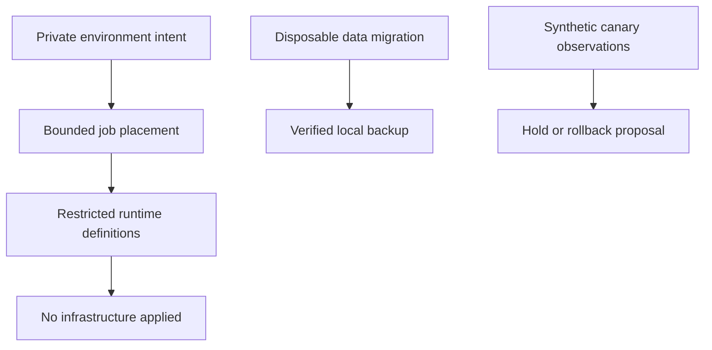

[All demonstrations](../DEMONSTRATIONS.md) · [All projects](../INTEGRATIONS.md)

# Deployment planning and recovery

Validate an environment, calculate placement, prepare runtime definitions, and exercise a local backup.

**Recorded synthetic demonstration · October 30, 2026 · No live cloud calls**

Image identity, capacity and canary observations are synthetic. Manifests and rollout decisions are not applied. Only the disposable local SQLite migration and backup execute.

## Observed outcomes
- The excess compute job is deferred rather than overfilling the supplied node.
- Restricted runtime definitions are prepared without applying infrastructure or starting containers.
- A real disposable SQLite backup preserves the synthetic row and passes integrity_check.
- A zero-sample canary window holds; a synthetic breached window proposes rollback.

## Flow



## Inspect the execution

The sequence below records actual local component results. Generated plans and supplied assertions are labeled at the step where they occur.

<a id="step-1"></a>

### 1. Validate a private staging intent

[luxleaf-environments](../projects/luxleaf-environments.md) · **executed local component**

<details>
<summary>Inspect recorded result</summary>

```json
{
  "name": "demo-staging",
  "stage": "staging",
  "network": "10.40.0.0/20",
  "replicas": 2,
  "regions": [
    "region-a"
  ],
  "validated": true,
  "provisioned": false
}
```

</details>

<a id="step-2"></a>

### 2. Fit two synthetic jobs into one node

[luxleaf-batch](../projects/luxleaf-batch.md) · **executed local component**

<details>
<summary>Inspect recorded result</summary>

```json
{
  "placements": [
    {
      "job_id": "priority-job",
      "node_id": "demo-node"
    }
  ],
  "deferred": [
    "deferred-job"
  ],
  "remaining": [
    {
      "id": "demo-node",
      "cpu": 0,
      "memory_mib": 512
    }
  ],
  "executed": false
}
```

</details>

<a id="step-3"></a>

### 3. Prepare a restricted deployment definition

[luxleaf-runtime](../projects/luxleaf-runtime.md) · **executed local component**

<details>
<summary>Inspect recorded result</summary>

```json
{
  "kinds": [
    "Deployment",
    "Service"
  ],
  "image": "registry.example/luxleaf@sha256:527577235c6e7edda6aa21485b5de825f40d8a22dbb4732009e9e240a1c5c713",
  "run_as_nonroot": true,
  "service_account_token_mounted": false,
  "applied": false
}
```

</details>

<a id="step-4"></a>

### 4. Prepare a restricted loopback container definition

[luxleaf-containers](../projects/luxleaf-containers.md) · **executed local component**

<details>
<summary>Inspect recorded result</summary>

```json
{
  "image": "registry.example/luxleaf@sha256:527577235c6e7edda6aa21485b5de825f40d8a22dbb4732009e9e240a1c5c713",
  "ports": [
    "127.0.0.1:8080:8080"
  ],
  "read_only": true,
  "cap_drop": [
    "ALL"
  ],
  "started": false
}
```

</details>

<a id="step-5"></a>

### 5. Migrate and verify a disposable local backup

[luxleaf-data](../projects/luxleaf-data.md) · **executed local component**

<details>
<summary>Inspect recorded result</summary>

```json
{
  "schema_revision": 1,
  "restored_synthetic_row_matches": true,
  "integrity_check": "ok"
}
```

</details>

<a id="step-6"></a>

### 6. Hold without evidence and roll back on a breached threshold

[luxleaf-rollouts](../projects/luxleaf-rollouts.md) · **executed with synthetic observation samples**

<details>
<summary>Inspect recorded result</summary>

```json
{
  "empty_window_decision": "hold_insufficient_evidence",
  "breached_window_state": "rolled_back",
  "proposed_traffic_percent": 0
}
```

</details>

## Checks that passed

- Validating the environment does not provision it.
- The excess job is deferred; no compute job starts.
- Runtime definitions share an image identifier without starting a service.
- The backup contains the original synthetic row and passes SQLite integrity_check.
- Missing evidence holds; a breached synthetic window proposes rollback.

## Evidence and scope

The [machine-readable record](record.json) contains the complete five-journey run, source commit identifiers and checks. The private developer kit contains the repeatable runner. Public CI checks this record’s structure, coverage and publication boundaries; it does not execute private code.

These results establish the demonstrated synthetic behavior. They do not measure production quality, infrastructure capacity, real approval authenticity or live provider availability. [Validation scope](../VALIDATION.md).
