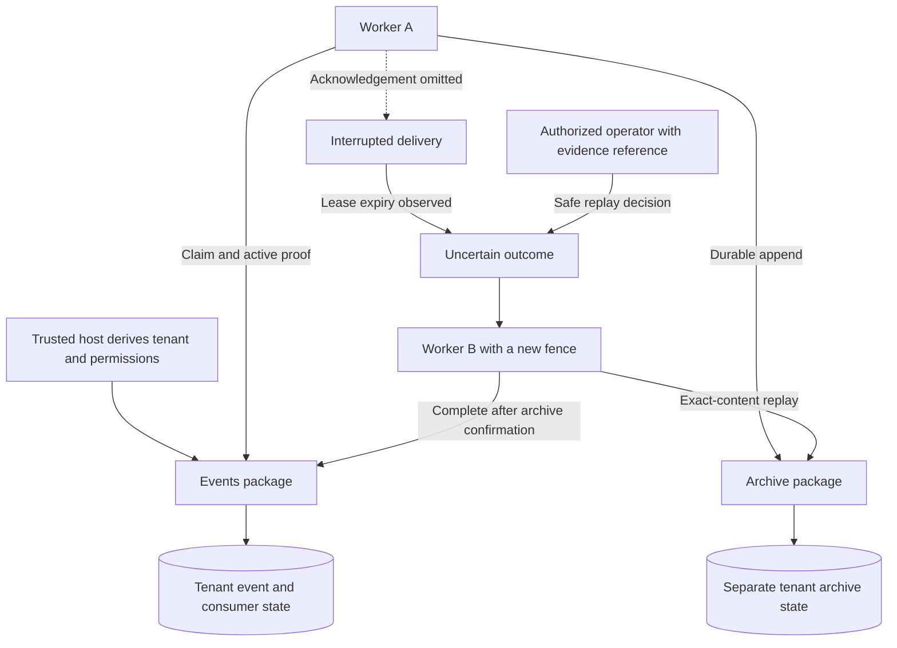
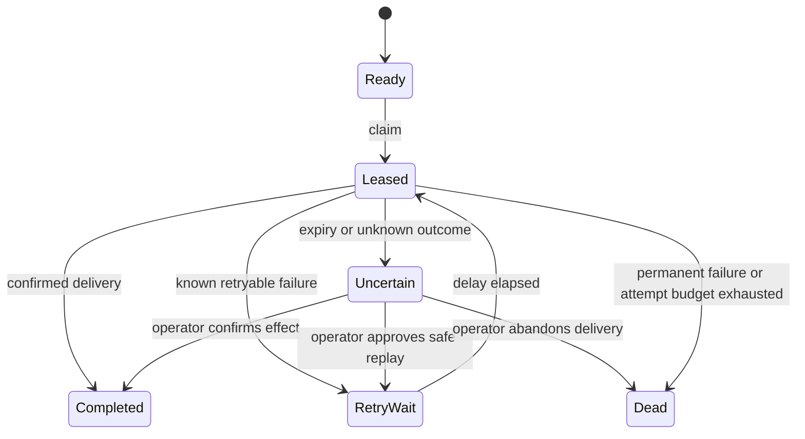

# Recovering an interrupted event delivery

[All demonstrations](../DEMONSTRATIONS.md) · [Event component](../projects/luxleaf-events.md) · [Archive component](../projects/luxleaf-archives.md)

**Events 0.2.0 · Archive 0.1.0 · Ten executable checks passed · October 31, 2026**

A worker can successfully write an event to an archive and stop before acknowledging delivery. Automatically retrying unknown effects is risky. This exercise demonstrates a local recovery protocol: exclusive claims, an explicit uncertain state, authorized replay against an idempotent archive, and rejection of stale acknowledgements.

## Architecture and trust boundary



These boxes are local library and storage boundaries, not independently deployed services. Event and archive transactions are separate. The host authenticates workers and operators; tenant, actor and evidence-reference fields do not authenticate themselves. The archive checks matching event identity and content, allowing this particular replay without creating another entry. Other sinks need their own verified replay contract.

## Executed recovery sequence

1. Append one synthetic workflow-completion event and claim it for the archive consumer.
2. Confirm a second worker cannot obtain the same active delivery.
3. Write the event to a disposable SQLite archive, then deliberately omit its acknowledgement.
4. Advance the injected host clock to the lease expiry. A new claim returns no delivery; the event is uncertain.
5. Supply a synthetic operator decision authorizing replay because this archive deduplicates exact content.
6. Claim with a replacement worker and a higher fence. The archive recognizes the existing entry.
7. Reject the old worker's acknowledgement, then complete the replacement worker's delivery.
8. Verify the archive chain contains one entry. Another consumer still has its own pending delivery.

The fault is modeled by omission and clock injection. The exercise does not terminate an operating-system process, simulate a remote network partition or run a cloud service.

## Recorded outcomes

| Executable assertion | Result |
|---|---|
| Second worker cannot claim an active delivery | Passed |
| First archive write is new | Passed |
| Expired delivery is held, not automatically retried | Passed |
| One uncertain outcome is visible | Passed |
| Replacement attempt advances the fence | Passed |
| Recovery reuses the existing archive entry | Passed |
| Old worker acknowledgement is rejected | Passed |
| One verified archive entry remains | Passed |
| Archive consumer has one completion | Passed |
| Another consumer still owns its independent pending delivery | Passed |

```json
{
  "uncertain_snapshot": {
    "counts": {
      "ready": 0,
      "leased": 0,
      "retry_wait": 0,
      "uncertain": 1,
      "dead": 0,
      "completed": 0
    },
    "total": 1
  },
  "recovery": {
    "archive_replayed": true,
    "attempt": 2,
    "fence": 2
  },
  "archive": {
    "valid": true,
    "entries": 1,
    "head_sha256": "097c085b027f9b24dfc848bed252bacc4c168f8b731f267a9be38b575e0cb010"
  },
  "final": {
    "counts": {
      "ready": 0,
      "leased": 0,
      "retry_wait": 0,
      "uncertain": 0,
      "dead": 0,
      "completed": 1
    },
    "total": 1
  }
}
```

[Inspect the full sanitized execution record](event-recovery-record.json). It identifies the event and archive implementation commits and confirms both exercised checkouts were clean. It excludes worker credentials and private filesystem paths. The private developer-kit package contains the reproducible runner; the public repository contains documentation and results.

## Delivery states and operating rules



The first claim fixes an attempt budget of at most 20. Lease duration is bounded to one hour, and explicit retry delay to one day. A stale worker cannot complete a newer attempt. Expired claims are never automatically replayed. Expiry is detected when a delivery operation runs, so there is no implied background scheduler. Dead and completed deliveries are terminal.

The existing pending-events view remains available for legacy clients and inspection. It includes all unacknowledged events, even leased or dead ones. Managed workers must use claim. Legacy acknowledgement cannot bypass a managed lease. Operators should back up state before upgrading and must not downgrade a managed database to the old implementation.

## Validation and remaining work

- Event component: 18 passing tests, including concurrent claims, tenant isolation, rejected proofs, retries and legacy compatibility.
- Portfolio: 143 component tests, 12 integration tests and 31 CLI examples passed locally.
- Recovery evidence: ten assertions passed. Integration tests also deliberately falsify archive replay and bypass stale-worker rejection; either fault stops the evidence runner.

This remains a bounded SQLite component: 1,000 events and 100 consumer identities per tenant, subject to existing state-size limits. Claims are locally serialized; no distributed throughput or exactly-once external effects are claimed. Remote delivery, lease renewal, retention, independently verified approval evidence and production load testing remain future work.

Original source remains proprietary to Michelle L. Wu in private repositories. Public material follows the [showcase license](../../LICENSE).
