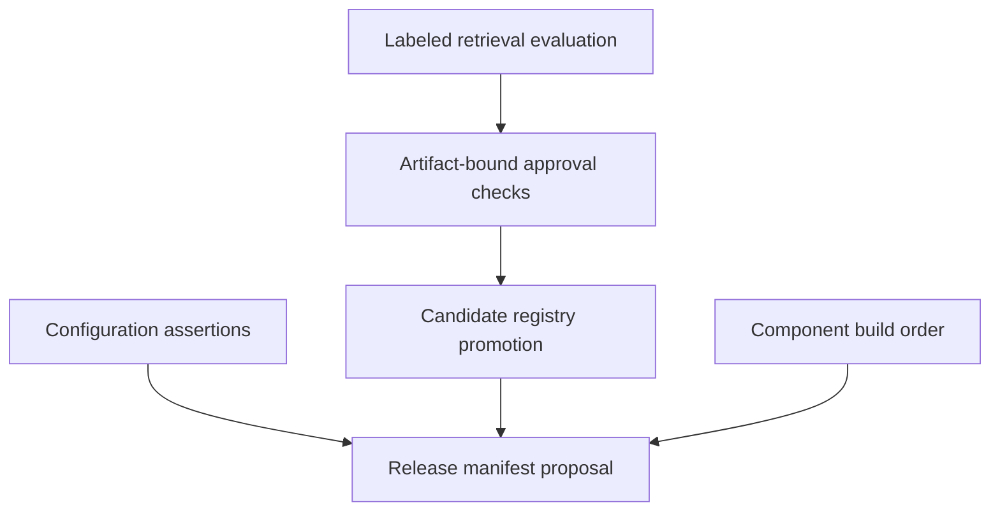

[All demonstrations](../DEMONSTRATIONS.md) · [All projects](../INTEGRATIONS.md)

# Evidence before release

Evaluate synthetic retrieval results, review an artifact, and prepare a release manifest.

**Recorded synthetic demonstration · October 30, 2026 · No live cloud calls**

Approvals, control assertions and release-gate assertions are synthetic fixtures. This does not perform an audit, authenticate reviewers or publish a release.

## Observed outcomes
- The positive retrieval case is found and the no-evidence case abstains.
- Self-approval is rejected; a candidate can be promoted only with a matching artifact approval.
- The 31-component build order resolves, and a synthetic release manifest is produced without publication.

## Flow



## Inspect the execution

The sequence below records actual local component results. Generated plans and supplied assertions are labeled at the step where they occur.

<a id="step-1"></a>

### 1. Score two labeled retrieval cases

[luxleaf-evaluations](../projects/luxleaf-evaluations.md) · **executed local component**

<details>
<summary>Inspect recorded result</summary>

```json
{
  "k": 1,
  "cases": [
    {
      "id": "policy",
      "precision_at_k": 1.0,
      "recall_at_k": 1.0,
      "reciprocal_rank": 1.0,
      "correct_abstention": null
    },
    {
      "id": "no-evidence",
      "precision_at_k": 0.0,
      "recall_at_k": null,
      "reciprocal_rank": 0,
      "correct_abstention": true
    }
  ],
  "mean_reciprocal_rank": 0.5,
  "mean_recall_at_k": 1.0
}
```

</details>

<a id="step-2"></a>

### 2. Evaluate independent artifact-bound approvals

[luxleaf-model-governance](../projects/luxleaf-model-governance.md) · **executed with synthetic review assertions**

<details>
<summary>Inspect recorded result</summary>

```json
{
  "artifact_sha256": "527577235c6e7edda6aa21485b5de825f40d8a22dbb4732009e9e240a1c5c713",
  "approved": true,
  "failed_checks": [],
  "missing_roles": []
}
```

</details>

<a id="step-3"></a>

### 3. The artifact author cannot approve their own release

[luxleaf-model-governance](../projects/luxleaf-model-governance.md) · **executed negative case**

<details>
<summary>Inspect recorded result</summary>

```json
{
  "rejected": true
}
```

</details>

<a id="step-4"></a>

### 4. Promote the matching approved candidate

[luxleaf-model-lifecycle](../projects/luxleaf-model-lifecycle.md) · **executed local component**

<details>
<summary>Inspect recorded result</summary>

```json
{
  "active": "candidate-1",
  "artifact_sha256": "527577235c6e7edda6aa21485b5de825f40d8a22dbb4732009e9e240a1c5c713",
  "promotions": 1
}
```

</details>

<a id="step-5"></a>

### 5. Evaluate supplied control assertions

[luxleaf-security](../projects/luxleaf-security.md) · **executed with synthetic configuration assertions**

<details>
<summary>Inspect recorded result</summary>

```json
{
  "passed": true,
  "findings": [],
  "controls_evaluated": 7,
  "certified": false
}
```

</details>

<a id="step-6"></a>

### 6. Resolve all 31 component build relationships

[luxleaf-developer-kit](../projects/luxleaf-developer-kit.md) · **executed local component**

<details>
<summary>Inspect recorded result</summary>

```json
{
  "build_order": [
    "luxleaf-agent-plans",
    "luxleaf-agent-runtime",
    "luxleaf-api",
    "luxleaf-archives",
    "luxleaf-batch",
    "luxleaf-cloud-tools",
    "luxleaf-containers",
    "luxleaf-data",
    "luxleaf-developer-kit",
    "luxleaf-environments",
    "luxleaf-evaluations",
    "luxleaf-events",
    "luxleaf-generation",
    "luxleaf-incidents",
    "luxleaf-inference",
    "luxleaf-knowledge",
    "luxleaf-metering",
    "luxleaf-model-router",
    "luxleaf-observability",
    "luxleaf-rag",
    "luxleaf-rollouts",
    "luxleaf-runtime",
    "luxleaf-security",
    "luxleaf-service-policy",
    "luxleaf-telemetry",
    "luxleaf-tool-protocol",
    "luxleaf-workflows",
    "luxleaf-workspace",
    "luxleaf-model-governance",
    "luxleaf-model-lifecycle",
    "luxleaf-delivery"
  ],
  "components": 31,
  "external_dependencies": []
}
```

</details>

<a id="step-7"></a>

### 7. Hash a synthetic release and evaluate declared gates

[luxleaf-delivery](../projects/luxleaf-delivery.md) · **executed with synthetic release-gate assertions**

<details>
<summary>Inspect recorded result</summary>

```json
{
  "manifest": {
    "candidate.json": {
      "sha256": "803b88f42076818670e04a5a0166254827cfc0ae304e795fa0d600d3a139fa68",
      "bytes": 129
    }
  },
  "manifest_sha256": "fc6e06185a1d077120dae7915a56781d26d35cb2e55653a9bb52247aee08781c",
  "release_allowed": true,
  "failed_gates": [],
  "published": false
}
```

</details>

## Checks that passed

- The labeled positive case is retrieved and the empty case abstains.
- The artifact author cannot approve their own release
- Registry promotion uses the exact reviewed artifact.
- An unsatisfied TLS assertion produces a finding.
- The complete component manifest orders the model dependencies correctly.
- Passing declared gates returns a proposal without publishing anything.

## Evidence and scope

The [machine-readable record](record.json) contains the complete five-journey run, source commit identifiers and checks. The private developer kit contains the repeatable runner. Public CI checks this record’s structure, coverage and publication boundaries; it does not execute private code.

These results establish the demonstrated synthetic behavior. They do not measure production quality, infrastructure capacity, real approval authenticity or live provider availability. [Validation scope](../VALIDATION.md).
