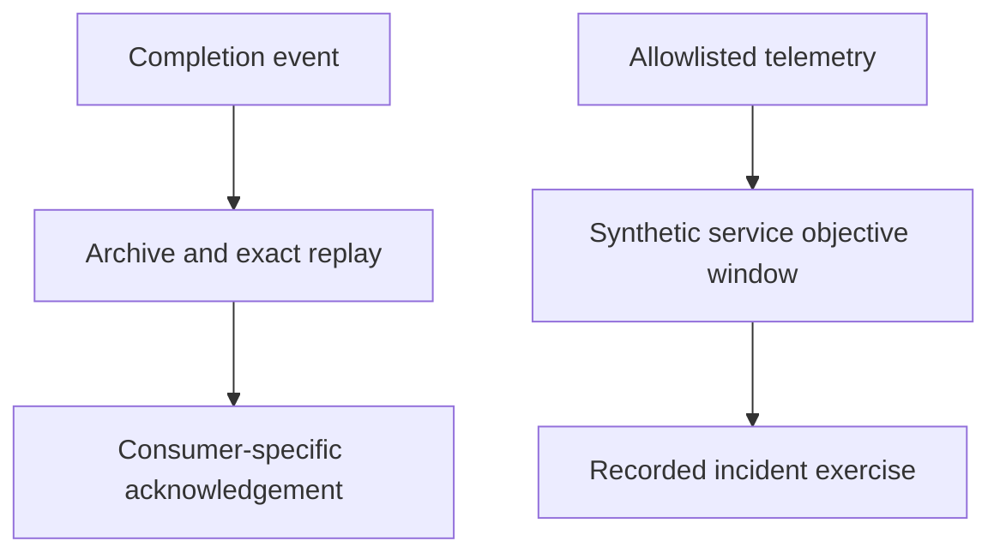

[All demonstrations](../DEMONSTRATIONS.md) · [All projects](../INTEGRATIONS.md)

# Operational evidence and response

Archive a completion event, remove content from telemetry, calculate a service objective and record an incident exercise.

**Recorded synthetic demonstration · October 30, 2026 · No live cloud calls**

All event data and response samples are synthetic. No collector, notification service or remote archive is contacted; the incident is an exercise.

## Observed outcomes
- Repeating an archive write preserves one entry; a separate consumer still sees its pending event.
- An unapproved content attribute is removed before telemetry export; nothing is exported.
- A synthetic 98% availability window breaches a 99% objective, followed by a complete recorded incident exercise.

## Flow



## Inspect the execution

The sequence below records actual local component results. Generated plans and supplied assertions are labeled at the step where they occur.

<a id="step-1"></a>

### 1. Verify archive delivery and exact replay

[luxleaf-archives](../projects/luxleaf-archives.md) · **executed local component**

<details>
<summary>Inspect recorded result</summary>

```json
{
  "first_write_replayed": false,
  "second_write_replayed": true,
  "entries": 1,
  "valid": true
}
```

</details>

<a id="step-2"></a>

### 2. Acknowledge only the completed consumer

[luxleaf-events](../projects/luxleaf-events.md) · **executed local component**

<details>
<summary>Inspect recorded result</summary>

```json
{
  "archive_pending": 0,
  "metrics_pending": 1
}
```

</details>

<a id="step-3"></a>

### 3. Drop unapproved content attributes

[luxleaf-telemetry](../projects/luxleaf-telemetry.md) · **executed local component**

<details>
<summary>Inspect recorded result</summary>

```json
{
  "operation": "workflow",
  "attributes": {
    "cost_micros": 0
  },
  "dropped_attribute_count": 1,
  "exported": false
}
```

</details>

<a id="step-4"></a>

### 4. Calculate a breached synthetic service window

[luxleaf-observability](../projects/luxleaf-observability.md) · **executed with synthetic response samples**

<details>
<summary>Inspect recorded result</summary>

```json
{
  "observed_requests": 100,
  "server_errors": 2,
  "availability": 0.98,
  "p50_ms": 59,
  "p95_ms": 104,
  "budget_consumed": 2.0,
  "status": "breached"
}
```

</details>

<a id="step-5"></a>

### 5. Complete the recorded response exercise

[luxleaf-incidents](../projects/luxleaf-incidents.md) · **executed local component**

<details>
<summary>Inspect recorded result</summary>

```json
{
  "id": "exercise-1",
  "status": "closed",
  "history": [
    "open",
    "acknowledged",
    "contained",
    "resolved",
    "closed"
  ]
}
```

</details>

## Checks that passed

- Archive replay does not duplicate the event; another consumer still has work.
- The content field is removed before the span is available for export.
- Two errors in a 100-request synthetic window breach the configured 99% objective.
- The owner follows the complete incident sequence.

## Evidence and scope

The [machine-readable record](record.json) contains the complete five-journey run, source commit identifiers and checks. The private developer kit contains the repeatable runner. Public CI checks this record’s structure, coverage and publication boundaries; it does not execute private code.

These results establish the demonstrated synthetic behavior. They do not measure production quality, infrastructure capacity, real approval authenticity or live provider availability. [Validation scope](../VALIDATION.md).
