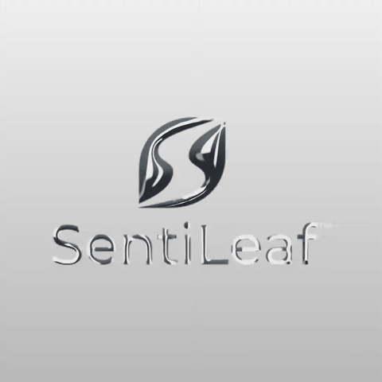

# SentiLeaf in liquid metal

An actual recording of the SentiLeaf logo in LuxLeaf Metal Mark, with flowing studio reflections and a clean gray gradient background.

**[Watch or download the full MP4](../../assets/visual-products/sentileaf-liquid-metal.mp4)** — 9.83 seconds, 960 × 960, 30 fps, no audio. GitHub may show a download button for video files; the animated preview above plays directly in the document.

## What changed

The uploaded logo had an opaque off-white background. Treating inverse brightness as transparency made that background reflect faintly, producing rectangular haze. The updated pipeline separates a uniform backdrop from the artwork, preserves soft logo edges and holes, and fits the artwork to the preview.

Video frames now include the same gradient or solid background selected in the editor. A separate transparent PNG export remains available for compositing. Paused motion is indicated explicitly before recording.

The demonstration was captured from the working browser renderer, not generated video. Its [capture record](../../assets/visual-products/sentileaf-record.json) reports the media hashes and a frame-change check. The local implementation passed 30 automated tests and 25 browser checks, including this logo and the exported background colors.

This is a development demonstration of metallic reflection with procedural surface motion. It is not a fluid simulation or a claim of production certification. The renderer and all four visual-product repositories are public again under their stated licenses while development continues. The public showcase contains the approved recorded media, with implementation source linked from the visual-product overview; it does not host a live editor. No new package release accompanies this demo.

SentiLeaf artwork was supplied by the owner for this demonstration. No separate trademark rights are granted. [Visual product overview](../VISUAL_PRODUCTS.md).
